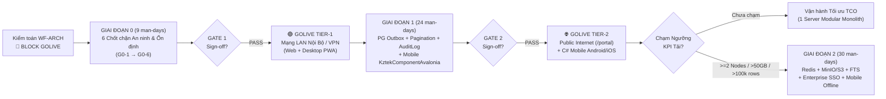

# ADR-001: Chiến Lược Kiến Trúc Tổng Thể, Cổng Kiểm Soát Golive (2-Tier Go/No-Go Gate) & Lộ Trình Đầu Tư 18 Tháng — KZTEK Work Management

- **Mã quyết định:** `ADR-001`
- **Tài liệu căn cứ:** `docs/architecture/ARCH-AUDIT-system-2026-11-02.md` (Tech Lead L3 — Bước 1.1 `WF-ARCH`)
- **Người ban hành:** CTO (L1 — Executive)
- **Ngày ban hành:** 2026-11-02
- **Mức độ ưu tiên:** P1 (Chiến lược Golive & Mở rộng quy mô doanh nghiệp)

---

## Trạng thái
**Accepted (Conditional Approval — Phê duyệt có điều kiện theo 2 cấp độ Golive & Ngưỡng KPI mở rộng)**

> **Hiệu lực tức thì:** Giữ nguyên hiệu lực chốt chặn **`🛑 BLOCK GOLIVE`** đối với bản mã nguồn hiện tại (commit `ef98568`). Nghiêm cấm mở cổng truy cập Internet công khai hoặc triển khai diện rộng trước khi vượt qua **Checklist Gate 1 (Phase G0)**.

---

## Bối cảnh

Hệ thống **KZTEK Work Management** đã hoàn thiện chiều sâu nghiệp vụ cốt lõi ấn tượng trên nền tảng **Modular Monolith hiện đại** (Next.js 16 App Router, React 19, Prisma 7, PostgreSQL 17 chuẩn tiếng Việt ICU, SWR Tab Cache `< 10ms`, Multiplexed SSE, Customer Ticket Portal `/portal`, tích hợp Zalo OA/ZNS – Discord – SMTP, cùng bản mẫu C# Avalonia Mobile).

Tuy nhiên, báo cáo kiểm toán mã nguồn độc lập `ARCH-AUDIT-system-2026-11-02` của **Tech Lead (L3)** đã xác nhận bằng dẫn chứng `file:line` sự tồn tại của các rủi ro chặn đứng khả năng vận hành thực tế:
1. **Rủi ro An ninh Nghiêm trọng (8/10 hạng mục OWASP Top 10 = FAIL):** Tồn tại chuỗi tấn công 2 bước chiếm quyền `ADMIN` tối cao trong `< 5 giây` không cần xác thực (`POST /api/auth/register` → `POST /api/users` hoặc `PATCH /api/users/[userId]`); Stored XSS qua `RichMarkdown`/`WysiwygEditor` và `/api/upload` (`.html`/`.svg`) kết hợp cookie phiên `httpOnly: false`; lộ toàn bộ khóa bí mật tích hợp (`SystemSetting` lưu plaintext, trả thẳng qua `GET /api/system/config` và ghi ra `console.log`); không có Rate-limiting và thiếu cơ chế thu hồi JWT 7 ngày.
2. **Rủi ro Độ tin cậy & Nút thắt Hiệu năng:** Hàm băm `scryptSync` đồng bộ khóa cứng Node.js Event Loop khi đăng nhập đồng thời; `NotificationQueue`, `boardBus` và `emailOutbox` nằm thuần trên RAM đơn tiến trình (mất trắng thông báo khi container restart/deploy); thiếu phân trang trên `Board`/`Tickets`; lỗi 404 thực tế trên `/desktop`.
3. **Độ lệch Đa nền tảng & Quy chuẩn Nội bộ:** Ứng dụng `mobile/KztekWorkManagement.Mobile/` đang gãy 2 API chính (`HTTP 404/405`), ghi cứng mật khẩu demo trên UI, dùng `Avalonia 11.0.10` mặc định (vi phạm **Rule R9** bắt buộc dùng `KztekComponentAvalonia` `12.1.0`) và trôi xa nghiệp vụ Web tháng 11/2026.

Ban Điều hành Công nghệ cần một quyết định kiến trúc dứt khoát nhằm cân bằng 3 mục tiêu chiến lược 1–3 năm của KZTEK: **(1) An toàn thông tin tuyệt đối**, **(2) Đưa sản phẩm vào vận hành sớm nhất có thể (Time-to-Value)**, và **(3) Tối ưu Tổng chi phí sở hữu (TCO) — không đầu tư hạ tầng dư thừa trước khi quy mô tải thực sự đòi hỏi**.

---

## Thẩm định Chiến lược của CTO đối với Báo cáo Tech Lead (Two-Eyes Review)

Sau khi thẩm định độc lập báo cáo `ARCH-AUDIT-system-2026-11-02`, CTO **đồng thuận cao** với chất lượng chẩn đoán kỹ thuật của Tech Lead, đồng thời ban hành **5 điều chỉnh chiến lược thực dụng** dưới góc nhìn ROI & TCO doanh nghiệp:

1. **Phân tách Golive thành 2 Cấp độ (2-Tier Golive) thay vì "All-or-Nothing":**
   - Không cần chờ hết Giai đoạn 1 (6–8 tuần) mới cho nhân sự KZTEK sử dụng. Ngay sau khi hoàn tất gói **Phase G0 (~9 man-days = 1.5–2 tuần)**, hệ thống đủ điều kiện mở **Tier-1 Golive (Internal LAN Pilot — mạng nội bộ KZTEK / VPN)**.
   - Riêng **Tier-2 Golive (Public Internet — mở cổng `/portal` cho khách hàng ngoài mạng & Webhooks Zalo/Discord công khai)** chỉ được phép kích hoạt sau khi hoàn tất thêm lớp bảo vệ chống spam công khai (Cloudflare Turnstile/CAPTCHA + Reverse Proxy Rate-limit), bảng nhật ký bất biến `SecurityAuditLog` và bộ kiểm thử tự động CI (`G1-4`).
2. **Đẩy tính bền vững của Hàng đợi Thông báo về Giai đoạn 1 bằng PostgreSQL Outbox (Zero-Extra-Infra TCO):**
   - Tech Lead đề xuất thay `NotificationQueue` RAM bằng **BullMQ + Redis** ở tận `G2-1` (6–18 tháng). Ở góc độ vận hành doanh nghiệp, việc rớt email/Zalo giao việc mỗi lần CI/CD deploy bản cập nhật trong suốt 6 tháng đầu là không chấp nhận được; ngược lại, dựng thêm cụm Redis ngay ở G1 cho quy mô `< 150` nhân sự lại làm tăng chi phí RAM server, backup và điểm lỗi vận hành.
   - **Chỉ đạo của CTO:** Bổ sung hạng mục **`G1-0` — PostgreSQL Transactional Outbox (`NotificationOutbox` + `SELECT ... FOR UPDATE SKIP LOCKED`)** ngay đầu Giai đoạn 1 (+2.0 man-days). Giải pháp này tận dụng chính PostgreSQL 17 sẵn có để đảm bảo **0% mất thông báo khi restart/redeploy**, có retry + Dead-Letter status với **chi phí hạ tầng tăng thêm = 0đ**. Giữ interface `INotificationQueue` làm `Seam` sạch để tương lai cắm BullMQ/Redis ở G2 không phải sửa code nghiệp vụ.
3. **Định hướng Rõ ràng cho C# Avalonia Mobile (Đóng băng ở G0 → Tái chuẩn hóa `KztekComponentAvalonia` ở G1):**
   - Tuyệt đối **không vá chắp vá** trên nền `Avalonia 11.0.10` dùng control mặc định hiện tại vì sẽ tạo nợ kỹ thuật kép và vi phạm Rule R9.
   - Tại **Tier-1 Golive (G0)**: Tạm đóng băng bản cài Mobile C# đối với người dùng cuối; kỹ sư hiện trường sử dụng giao diện Web Responsive / PWA trên trình duyệt di động.
   - Tại **Giai đoạn 1 (`G1-3` — 8.0 man-days)**: Đầu tư bài bản nâng cấp lên **Avalonia `12.1.0` + 100% thư viện nội bộ `KztekComponentAvalonia`**, tách cấu trúc `.Android` / `.iOS`, sửa đồng bộ API contract và tích hợp `SecureStorage`.
4. **Áp đặt "Ngưỡng Kích Hoạt Định Lượng" (KPI Triggers) cho Giai đoạn 2 — Chống Over-engineering:**
   - Giữ vững kiến trúc **Modular Monolith** trong 12–24 tháng tới. Nghiêm cấm tách Microservices hoặc triển khai sớm Redis/MinIO chỉ vì "xu hướng công nghệ". Mọi khoản đầu tư ở Giai đoạn 2 chỉ được giải ngân khi hệ thống giám sát ghi nhận chạm các ngưỡng KPI định lượng nêu tại mục Điều kiện bên dưới.
5. **Lưu ý Tương thích Kiến trúc Next.js 16 cho `G0-1`:**
   - Khi xây dựng chốt chặn biên HTTP tập trung, Tech Lead chỉ đạo Senior Dev tuân thủ chuẩn Next.js 16 (`src/proxy.ts` kết hợp Higher-Order Wrapper `withApiAuth(permission)` bọc trực tiếp tại từng Route Handler) nhằm đảm bảo phòng thủ chiều sâu (Defense-in-Depth) và không vướng cảnh báo deprecation của framework.

---

## Các phương án đã xem xét

### Phương án A: Vá nóng tối thiểu ở giao diện rồi Golive toàn diện (LAN + Internet) ngay lập tức
- **Ưu:** Đưa hệ thống vào sử dụng gần như tức thì (1–2 ngày công); không phát sinh chi phí chờ đợi ngắn hạn.
- **Nhược:** **Rủi ro an ninh thảm họa.** Lỗ hổng leo thang đặc quyền `ADMIN` không cần xác thực, Stored XSS lấy cắp JWT và lộ plaintext secrets tích hợp có thể khiến hệ thống bị chiếm quyền điều khiển hoàn toàn, rò rỉ dữ liệu dự án/khách hàng KZTEK và phát tán mã độc qua Zalo OA/SMTP công ty. **→ Bác bỏ hoàn toàn.**

### Phương án B (ĐƯỢC CHỌN): Modular Monolith Cứng Hóa Phân Tầng + Golive 2 Cấp + Mở Rộng Theo Ngưỡng KPI
- **Ưu:**
  - Khóa chặt 100% rủi ro bảo mật `Critical` và lỗi treo Event Loop chỉ với **~9 man-days (1.5–2 tuần)** để sớm khai thác giá trị kinh doanh trên mạng nội bộ (**Tier-1 LAN Pilot**).
  - Giữ nguyên kiến trúc **Modular Monolith + PostgreSQL 17** tinh gọn, chi phí vận hành hạ tầng (TCO) thấp nhất (chỉ 1 VPS/Server Linux chạy Docker Compose `app` + `db` + Reverse Proxy), đội ngũ dễ bảo trì và debug.
  - Chuẩn hóa bền vững C# Avalonia Mobile theo đúng tài sản công nghệ lõi `KztekComponentAvalonia` (Rule R9) ở Giai đoạn 1 mà không làm chậm tiến độ Golive Web.
  - Mọi chi phí hạ tầng lớn (Redis, MinIO/S3, SSO, Mobile Offline SQLite) được neo chặt vào ngưỡng tăng trưởng thực tế (Pay-as-you-grow).
- **Nhược:**
  - Chậm thời điểm mở cổng `/portal` ra Internet công khai khoảng 4–6 tuần so với Golive nội bộ để hoàn tất lớp kiểm toán bảo mật & CI test tự động.
  - Cần kỷ luật kiến trúc chặt chẽ từ Tech Lead (tách God Components, giữ `Seam`/`Adapter` sạch) để Modular Monolith không thoái hóa thành Big Ball of Mud.

### Phương án C: Đóng băng Golive 3–6 tháng để tái kiến trúc Microservices & Hạ tầng Phân tán (Redis + S3 + Event Broker) ngay từ đầu
- **Ưu:** Sẵn sàng cho quy mô hàng chục nghìn người dùng ngay ngày đầu; tách biệt độc lập dịch vụ Ticket, Core PM, Notification và File Storage.
- **Nhược:** **Over-engineering điển hình.** Tốn `> 60–90 man-days` phát triển lại, tăng gấp 3–4 lần TCO hạ tầng và chi phí vận hành DevOps (distributed tracing, network latency, eventual consistency), đánh mất cơ hội thu thập phản hồi thực tế từ nhân sự KZTEK trong nửa năm. **→ Bác bỏ.**

---

## Quyết định (CTO Executive Decision Block)

1. **Quyết định:** **CÓ — Phê duyệt có điều kiện (Conditional Approval — Chọn Phương án B).** Giữ nguyên lệnh **`🛑 BLOCK GOLIVE`** hiện tại cho đến khi hoàn tất nghiệm thu Giai đoạn 0.
2. **Lý do (3–5 dòng):**
   Kiến trúc Modular Monolith trên nền Next.js 16 + PostgreSQL 17 hiện tại hoàn toàn đáp ứng tải mục tiêu 1–2 năm đầu của KZTEK với TCO tối ưu nhất, nhưng đang hở sườn nghiêm trọng ở tầng kiểm soát truy cập API, XSS và quản lý khóa bí mật. Phương án B cho phép xử lý dứt điểm toàn bộ rủi ro P0 trong 9 ngày công để đưa sản phẩm vào vận hành nội bộ sinh lời ngay (Tier-1 LAN), đồng thời dùng PostgreSQL Outbox và chuẩn hóa `KztekComponentAvalonia` ở Giai đoạn 1 để hoàn thiện độ tin cậy đa nền tảng trước khi mở ra Internet (Tier-2), tránh hoàn toàn bẫy đầu tư hạ tầng phân tán lãng phí khi chưa chạm ngưỡng tải.
3. **Điều kiện kèm theo:**
   - **Điều kiện 1 (Gate Tier-1 LAN Pilot):** Hoàn thành 100% 6 gói công việc `G0-1` → `G0-6`, đạt `10/10` tiêu chí tại Checklist Gate 1, có xác nhận độc lập của `Tech Lead` + `QA Lead` + `DevOps Lead`. Cấm mở port `3000`/`5432` trực tiếp ra Internet và tạm đóng băng bản cài Mobile C# cũ.
   - **Điều kiện 2 (Gate Tier-2 Public Internet):** Hoàn thành bổ sung `G1-0` (PostgreSQL Outbox), `G1-1` (Pagination & Strict TS), `G1-4` (`SecurityAuditLog` + CI Test Gate + Cloudflare Turnstile/WAF Rate-limit trên `/portal`) trước khi trỏ tên miền công khai.
   - **Điều kiện 3 (KPI Gate giải ngân Giai đoạn 2):** Chỉ kích hoạt `G2-1` (Redis) khi cần chạy `>= 2` container `app` hoặc `> 200` kết nối SSE đồng thời; chỉ kích hoạt `G2-2` (MinIO/S3) khi dung lượng `uploads-data` vượt `50 GB` hoặc tệp media gây nghẽn băng thông container Web; chỉ kích hoạt `G2-3` (`tsvector` FTS) khi tổng bản ghi vượt `100.000` hoặc độ trễ tìm kiếm P95 `> 200ms`.
4. **Người thực thi (Theo Chain-of-Command KZTEK):**
   - **Engineering Manager (L2):** Lập kế hoạch phân bổ nguồn lực Sprint cho G0 (ngay lập tức) và G1; giám sát tiến độ và ngân sách man-days.
   - **Tech Lead (L3):** Chủ trì thiết kế chi tiết và review khắt khe (`security-audit-stride` + `/verify-pr`) cho các workflow `WF-HOTFIX` / `WF-BUGFIX` (Phase G0), `WF-REFACTOR` (`G1-1`, `G1-2`), và `WF-FEATURE` (`G1-0`, `G1-3`, `G1-4`).
   - **QA Lead (L3) & DevOps Lead (L3):** Thực thi quyền VETO (Rule R5) nếu còn bất kỳ lỗi P0/P1 nào; thiết lập Docker hardening, backup `pg_dump` tự động và sign-off hạ tầng ở mỗi Gate.
5. **Review tiếp theo:**
   - **Gate Review #1 (Nghiệm thu G0 — Mở Tier-1 LAN):** **2026-11-16** (T + 2 tuần).
   - **Gate Review #2 (Nghiệm thu G1 — Mở Tier-2 Internet & Mobile R9):** **2026-12-28** (T + 8 tuần).
   - **Đánh giá Kiến trúc & Ngưỡng KPI Giai đoạn 2 định kỳ:** **2027-03-31** (Cuối Quý 1/2027, hoặc sớm hơn nếu chạm 80% ngưỡng KPI).

---

## Ma Trận Ưu Tiên Đầu Tư (Impact vs Effort) & Lộ Trình Thực Thi

### Bảng Phân Bổ Danh Mục Đầu Tư Kỹ Thuật (Đã Tinh Chỉnh Chiến Lược CTO)

| Góc ưu tiên | Mã | Hạng mục đầu tư (Tinh chỉnh từ `ARCH-AUDIT`) | Tác động (Impact) | Chi phí (Effort) | Workflow KZTEK áp dụng | Mốc bắt buộc / Ngưỡng kích hoạt |
|---|---|---|---|---|---|---|
| **Q1 — Làm Ngay (Blocker)** | **G0-1** | `withApiAuth()` + Next.js 16 `src/proxy.ts` + Khóa lỗ hổng leo thang `ADMIN` (`/api/users`, `/register`, `/attachments`, `/tickets`, `/email-logs`) | Cực cao (Chặn chiếm quyền Admin) | 2.0 ngày | `WF-HOTFIX` (kèm `security-audit-stride`) | **Bắt buộc trước Tier-1 LAN** |
| **Q1 — Làm Ngay (Blocker)** | **G0-2** | Chuẩn hóa `isomorphic-dompurify` (`RichMarkdown` + `WysiwygEditor`), escape HTML Email & bật `httpOnly: true` cho Cookie phiên | Cực cao (Chặn XSS đánh cắp phiên) | 1.5 ngày | `WF-HOTFIX` (+ `UXR` kiểm tra Editor/Login) | **Bắt buộc trước Tier-1 LAN** |
| **Q1 — Làm Ngay (Blocker)** | **G0-3** | Mã hóa AES-256-GCM cho `SystemSetting`, che secret ở `GET /api/system/config`, bỏ fallback `AUTH_SECRET`, xóa `console.log` & `cookies.txt` | Cực cao (Chặn lộ khóa tích hợp) | 1.5 ngày | `WF-HOTFIX` | **Bắt buộc trước Tier-1 LAN** |
| **Q1 — Làm Ngay (Blocker)** | **G0-4** | Rate-Limiter (Login/Public Ticket/Upload), chặn upload `.html/.svg/.js` + Security Headers (`CSP`, `nosniff`), bắt buộc `oaSecretKey` Zalo | Cao (Chống DoS & Web Shell/XSS) | 1.5 ngày | `WF-HOTFIX` | **Bắt buộc trước Tier-1 LAN** |
| **Q1 — Làm Ngay (Blocker)** | **G0-5** | Chuyển `scryptSync` sang `crypto.scrypt` async + Cơ chế thu hồi JWT (`tokenVersion`) + Cưỡng chế `mustChangePassword` ở tầng API | Cao (Chống treo Server & giữ phiên bẩn) | 1.0 ngày | `WF-HOTFIX` | **Bắt buộc trước Tier-1 LAN** |
| **Q1 — Làm Ngay (Blocker)** | **G0-6** | Sửa lỗi `/desktop` 404, Transaction sinh `Task.number`, khóa port DB `127.0.0.1:5432`, thêm `/api/health` + cron `pg_dump` hàng ngày | Cao (Toàn vẹn dữ liệu & Backup) | 1.5 ngày | `WF-BUGFIX` + `WF-DEVOPS` | **Bắt buộc trước Tier-1 LAN** |
| **Q2 — Cốt Lõi Ngắn Hạn** | **G1-0** | *(CTO bổ sung)* **PostgreSQL Transactional Outbox** thay hàng đợi RAM (`FOR UPDATE SKIP LOCKED` + Retry + giữ `INotificationQueue` Seam) | Cao (0% mất thông báo khi deploy, 0đ hạ tầng) | 2.0 ngày | `WF-FEATURE` | **Trước Tier-2 Internet** |
| **Q2 — Cốt Lõi Ngắn Hạn** | **G1-4** | Bảng `SecurityAuditLog` + Cloudflare Turnstile trên `/portal` + Bộ Test Tự động (Vitest + Playwright) chặn trên GitHub Actions CI | Cao (Chống chối bỏ & Chống hồi quy lỗi) | 4.0 ngày | `WF-FEATURE` + `WF-TEST` + `WF-DEVOPS` | **Bắt buộc trước Tier-2 Internet** |
| **Q2 — Cốt Lõi Ngắn Hạn** | **G1-1** | Phân trang `Board`/`Tickets`/`Notifications`, tự động ẩn task `DONE > 30 ngày` & Gỡ bỏ `ignoreBuildErrors: true` (Strict TS Build) | Cao (Ổn định hiệu năng dài hạn) | 4.0 ngày | `WF-REFACTOR` | **Trước Tier-2 Internet** |
| **Q2 — Cốt Lõi Ngắn Hạn** | **G1-3** | Chuẩn hóa C# Avalonia Mobile lên **Avalonia `12.1.0` + 100% `KztekComponentAvalonia` (Rule R9)**, sửa 2 API 404/405, `SecureStorage`, `MyWork` & Android/iOS | Trung bình–Cao (Đồng bộ đa nền tảng chuẩn KZTEK) | 8.0 ngày | `WF-MIGRATE` / `WF-FEATURE` | **Mốc phát hành Mobile v1.0** |
| **Q3 — Dọn Nợ Kỹ Thuật** | **G1-2** | Tách 7 God Components (`< 350 dòng/file`) tăng `Locality` + Nối kênh Realtime SSE cho `MyWork` & `Desktop` | Trung bình (Tăng tốc độ bảo trì) | 5.0 ngày | `WF-REFACTOR` (+ `UXR`) | Trong chu kỳ G1 (Tháng 2–3) |
| **Q3 — Dọn Nợ Kỹ Thuật** | **G1-5** | Chuẩn hóa đường dẫn `CORE.md`, cập nhật `CODE-GRAPH.md` (`PostgreSQL 17`), dọn `electron` thừa & tối ưu lưu trữ file `.docx/.pdf` trung gian | Thấp–Trung bình (Vệ sinh kho mã) | 1.0 ngày | `WF-REFACTOR` | Ngay đầu G1 |
| **Q4 — Đầu Tư Theo KPI** | **G2-1** | Nâng cấp `INotificationQueue` sang **BullMQ + Redis** & `boardBus` sang **Redis Pub/Sub** phục vụ chạy đa bản sao (Multi-Replica) | Cao khi Scale ngang | 4.0 ngày *(giảm từ 6d nhờ có sẵn Seam G1-0)* | `WF-ARCH` → `WF-FEATURE` + `WF-DEVOPS` | **KPI:** Cần `>= 2` app containers HOẶC `> 200` concurrent SSE users |
| **Q4 — Đầu Tư Theo KPI** | **G2-2** | Trích xuất `IStorageAdapter` & chuyển tải tệp lớn sang **MinIO / S3 Presigned URL** | Cao khi nhiều video hiện trường | 5.0 ngày | `WF-FEATURE` + `WF-DEVOPS` | **KPI:** Volume `uploads-data > 50 GB` HOẶC nghẽn I/O video |
| **Q4 — Đầu Tư Theo KPI** | **G2-3** | Tìm kiếm toàn văn tiếng Việt PostgreSQL (`unaccent` + GIN `tsvector`) | Trung bình–Cao | 3.0 ngày | `WF-FEATURE` | **KPI:** Tổng bản ghi `> 100.000` HOẶC P95 search `> 200ms` |
| **Q4 — Đầu Tư Theo KPI** | **G2-4** | Enterprise Auth (SSO OIDC, 2FA/TOTP cho Admin, Access/Refresh Token Rotation) & OpenTelemetry + Prometheus/Grafana | Cao (Chuẩn Enterprise) | 8.0 ngày | `WF-FEATURE` + `WF-DEVOPS` | **KPI:** Yêu cầu tích hợp SSO tập đoàn HOẶC `> 300` active users |
| **Q4 — Đầu Tư Theo KPI** | **G2-5** | Offline-First SQLite Sync Engine & Native Push Notifications (FCM/APNs) cho C# Avalonia Mobile | Trung bình–Cao (Đặc thù công trình xa) | 10.0 ngày | `WF-FEATURE` | **KPI:** Sau khi Mobile `G1-3` vận hành ổn định `>= 60 ngày` ngoài thực địa |

> **Tổng hợp Ngân sách Kỹ thuật:**
> - **Giai đoạn 0 (Chốt chặn Tier-1 LAN):** **9.0 man-days** *(Cam kết giải ngân ngay)*
> - **Giai đoạn 1 (Hoàn thiện Tier-2 Internet & Mobile R9):** **24.0 man-days** *(Cam kết trong Tháng 1–2 sau Golive LAN)*
> - **Giai đoạn 2 (Mở rộng quy mô theo KPI):** **30.0 man-days** *(Dự phòng có điều kiện — chỉ giải ngân từng mô-đun khi chạm KPI)*

---

## Checklist Go/No-Go Gate Bắt Buộc Trước Golive

### Gate 1 — Điều kiện Mở Golive Tier-1 (Mạng LAN Nội Bộ KZTEK / VPN)
- [ ] **1. Khóa Leo thang Đặc quyền (A01):** Đã kiểm chứng tự động rằng tài khoản `MEMBER`/`VIEWER` và người dùng ẩn danh nhận `HTTP 401/403` khi gọi `POST /api/users`, `PATCH/DELETE /api/users/[id]`, `/api/auth/register`, `DELETE /api/attachments/[id]`, `/api/notifications/email-logs`.
- [ ] **2. Chặn Lộ dữ liệu Ticket Nội bộ (A01/I):** `GET /api/tickets/[ticketId]` khi không có phiên nhân viên hợp lệ tuyệt đối không trả về `internalNotes` và bình luận nội bộ; `POST .../comments` công khai luôn ép cứng `isStaff = false` ở server.
- [ ] **3. Triệt tiêu Stored XSS & Bảo vệ Phiên (A03/A05):** Toàn bộ luồng hiển thị/soạn thảo HTML đi qua `DOMPurify`; cookie `flowboard_session` bật `httpOnly: true`, `sameSite: "lax"`; luồng đăng nhập & SWR Cache hoạt động trơn tru trên cả HTTP LAN (`COOKIE_SECURE=false`) và HTTPS (`COOKIE_SECURE=true`).
- [ ] **4. Bảo mật Khóa tích hợp (A02/A09):** Các trường secret trong `SystemSetting` được mã hóa AES-256-GCM dưới DB; `GET /api/system/config` chỉ trả giá trị đã che (`******`); xóa sạch `console.log(body)` và gỡ `cookies.txt` khỏi Git.
- [ ] **5. An toàn Tải tệp & Rate-Limit cơ sở (A04/A07):** Chặn tuyệt đối các phần mở rộng thực thi web (`.html`, `.svg`, `.js`, `.xhtml`), đính kèm `X-Content-Type-Options: nosniff`; bật Rate-limit chống brute-force trên `/api/auth/login`.
- [ ] **6. Không khóa Event Loop & Kiểm soát Vòng đời Token (A07/Perf):** Đã thay `scryptSync` bằng `scrypt` bất đồng bộ; đổi mật khẩu lập tức vô hiệu hóa mọi JWT cũ qua `tokenVersion`; tài khoản `mustChangePassword = true` bị chặn ở mọi API nghiệp vụ cho tới khi đổi xong mật khẩu.
- [ ] **7. Toàn vẹn Nghiệp vụ Web & Desktop:** Trang `/desktop` cập nhật và tạo mới công việc thành công 100% (không còn lỗi 404); tạo nhiều task đồng thời không phát sinh lỗi trùng mã `P2002`.
- [ ] **8. An toàn Hạ tầng & Sao lưu (Infra):** Cổng PostgreSQL chỉ lắng nghe nội bộ (`127.0.0.1` / Docker bridge); container `app` có `/api/health` trạng thái `healthy`; cronjob `pg_dump` hàng ngày đã chạy thử và **đã diễn tập khôi phục (restore test) thành công tối thiểu 1 lần**.
- [ ] **9. Đóng băng Client Chưa Đạt Chuẩn:** Chưa phân phối bộ cài `KztekWorkManagement.Mobile` cũ (còn mật khẩu demo cứng và lỗi 404/405) cho người dùng cuối.
- [ ] **10. Nghiệm thu Độc lập (Two-Eyes Sign-off):** Có báo cáo `PASS` của `security-audit-stride` từ Tech Lead, Smoke/Regression Sign-off của QA Lead và xác nhận hạ tầng của DevOps Lead.

### Gate 2 — Điều kiện Bổ sung Mở Golive Tier-2 (Public Internet `/portal` & Mobile v1.0)
- [ ] **1. Chống Spam & Lạm dụng Tài nguyên Công khai:** Cổng `/portal` (`/api/tickets/public` và upload đính kèm khách hàng) đã tích hợp Cloudflare Turnstile/CAPTCHA, giới hạn dung lượng tệp công khai hợp lý (VD: `<= 20MB` cho khách vãng lai) và đứng sau Reverse Proxy Nginx/Caddy có TLS 1.3 + giới hạn băng thông/tốc độ kết nối.
- [ ] **2. Bền vững Hàng đợi Thông báo (`G1-0`):** Bảng `NotificationOutbox` hoạt động ổn định; thử nghiệm `docker compose restart app` giữa lúc đang bắn 50 thông báo xác nhận **0 thông báo bị mất**.
- [ ] **3. Truy vết Kiểm toán (`G1-4`):** Bảng `SecurityAuditLog` ghi nhận đầy đủ mọi thao tác nhạy cảm (đăng nhập thất bại nhiều lần, tạo/xóa user, đổi role, sửa `SystemSetting`, điều phối Ticket).
- [ ] **4. Chốt chặn Chất lượng Tự động trên CI (`G1-1`, `G1-4`):** Đã gỡ bỏ `ignoreBuildErrors: true` trong `next.config.ts`; GitHub Actions chạy tự động `tsc --noEmit` + `Vitest` + `Playwright` xanh 100% trước khi cho phép build image release.
- [ ] **5. Chuẩn hóa Ứng dụng Di động (`G1-3` — Nếu phát hành kèm):** Đạt 100% tuân thủ `KztekComponentAvalonia` (`12.1.0`) theo Rule R9, không còn mật khẩu cứng, lưu phiên bằng `SecureStorage` và đồng bộ đầy đủ nghiệp vụ với Web.

---

## Hệ quả (Consequences)

- **Tích cực (Positive):**
  - Loại bỏ triệt để nguy cơ mất quyền kiểm soát hệ thống, rò rỉ bí mật tích hợp và mất dữ liệu thông báo trước khi đưa vào vận hành thực tế.
  - Đưa hệ thống phục vụ nội bộ KZTEK chỉ sau **~1.5–2 tuần** thay vì phải chờ tái cấu trúc dài hạn, tối đa hóa hiệu suất vốn đầu tư kỹ thuật (ROI).
  - Giữ chi phí hạ tầng máy chủ ở mức tối thiểu trong suốt giai đoạn 50–200 người dùng nhờ khai thác triệt để sức mạnh sẵn có của PostgreSQL 17 (Pool + Index + Outbox + FTS) trên kiến trúc Modular Monolith.
  - Bảo đảm tính nhất quán thương hiệu và khả năng tái sử dụng linh kiện nội bộ lâu dài nhờ kiên định chuẩn hóa C# Mobile sang `KztekComponentAvalonia` (Rule R9).
- **Đánh đổi / Chấp nhận rủi ro có kiểm soát (Negative / Trade-offs):**
  - Trong 1.5–2 tuần thực hiện Phase G0, toàn bộ tính năng giao diện mới không khẩn cấp phải tạm dừng ưu tiên để dồn 100% lực lượng Senior Dev + QA đóng các lỗ hổng P0.
  - Trong giai đoạn chạy 1 container (trước khi chạm ngưỡng bật `G2-1` Redis), mỗi đợt deploy phiên bản mới sẽ làm kết nối SSE của trình duyệt tự động kết nối lại sau `1–3 giây` (EventSource auto-reconnect có sẵn của trình duyệt — hoàn toàn chấp nhận được với ứng dụng quản lý công việc doanh nghiệp, trong khi thông báo nền đã được bảo toàn bởi PostgreSQL Outbox `G1-0`).

---

## Người chịu trách nhiệm thực thi
- **Chịu trách nhiệm tổng thể tiến độ & nguồn lực:** `Engineering Manager (L2)`
- **Chịu trách nhiệm thiết kế kỹ thuật, kiểm định bảo mật & Code Review:** `Tech Lead (L3)` (cùng đội ngũ `Senior Developer (L4)` / `Junior Developer (L5)`)
- **Chịu trách nhiệm kiểm thử nghiệm thu & quyền VETO chất lượng:** `QA Lead (L3)` & `QA Engineer (L5)` (phối hợp `UX/UI Reviewer (L5)` cho các hạng mục chạm giao diện Editor/Desktop/Mobile)
- **Chịu trách nhiệm cứng hóa Docker, Backup, Reverse Proxy & CI/CD:** `DevOps Lead (L3)` & `DevOps Engineer (L5)`

---

## Review tiếp theo
- **2026-11-16:** Họp nghiệm thu **Gate 1 (Phase G0)** — Quyết định mở Golive Tier-1 LAN nội bộ.
- **2026-12-28:** Họp nghiệm thu **Gate 2 (Phase G1)** — Quyết định mở Golive Tier-2 Public Internet & phát hành C# Avalonia Mobile chuẩn R9.
- **2027-03-31:** Đánh giá định kỳ Quý 1/2027 đối chiếu số liệu vận hành thực tế với bộ ngưỡng **KPI Giai đoạn 2**.

---

## Ký duyệt
- **CTO (L1 — Executive):** *Đã thẩm định & Phê duyệt có điều kiện (Conditional Approval)* — Ngày **2026-11-02**
