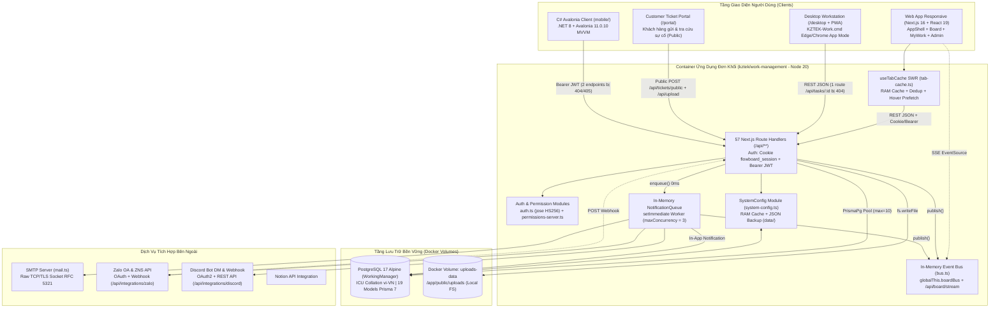

# Báo Cáo Kiểm Toán Kiến Trúc Toàn Diện & Đề Xuất Kỹ Thuật — KZTEK Work Management

- **Mã tài liệu:** `ARCH-AUDIT-system-2026-11-02`
- **Workflow:** `WF-ARCH` (Bước 1.1 — Khảo sát & Phân tích Kỹ thuật Toàn diện)
- **Tác giả:** Tech Lead (L3 — Lead)
- **Người thẩm định tiếp theo:** CTO (L1 — Executive, Bước 2.1)
- **Ngày thực hiện:** 2026-11-02
- **Mức độ ưu tiên:** P1 (Chuẩn bị Golive & Mở rộng quy mô sử dụng)
- **Chế độ khảo sát:** Read-Only Audit (100% dẫn chứng `CONFIRMED` từ mã nguồn thực tế `file:line`)

---

## ASSUMPTIONS I'M MAKING

```text
ASSUMPTIONS I'M MAKING:
1. Phạm vi vận hành mục tiêu (Golive Target): Hệ thống sẽ chuyển từ môi trường nội bộ LAN đơn lẻ sang phục vụ đồng thời cả mạng nội bộ KZTEK (Web + Desktop PWA + Mobile) lẫn khách hàng bên ngoài qua Internet trên Cổng Ticket (/portal) và Webhook Zalo/Discord.
2. Quy mô tải mục tiêu (12–18 tháng tới): Tăng trưởng từ quy mô vài chục nhân sự nội bộ lên hàng trăm người dùng đồng thời, hàng chục dự án song song, hàng chục nghìn công việc (Tasks), bình luận và tệp đính kèm (ảnh/video hiện trường).
3. Hạ tầng triển khai tiêu chuẩn: Triển khai qua Docker Compose trên máy chủ Linux on-premise hoặc VPS Cloud của KZTEK (Reverse Proxy Nginx/Caddy đặt phía trước container `app:3000` và `db:5432`).
4. Ràng buộc công nghệ KZTEK: Tuân thủ nghiêm ngặt Rule R9 (ứng dụng C# Avalonia bắt buộc chuẩn hoá lên thư viện nội bộ `KztekComponentAvalonia`) và quy trình kiểm soát chất lượng Two-Eyes của hệ thống `.gemini/`.
→ Xác nhận lại ngay với CTO/User ở Bước 2.1 hoặc kiến trúc lộ trình dưới đây sẽ tiếp tục làm cơ sở ban hành ADR.
```

---

## 1. Bối Cảnh, Phương Pháp Kiểm Toán & Giải Quyết Các Điểm `UNCERTAIN`

Đợt kiểm toán này áp dụng kết hợp:
- **Từ vựng thiết kế chuẩn (`codebase-design`):** `Module`, `Interface`, `Depth`, `Seam`, `Adapter`, `Leverage`, `Locality` để chỉ rõ điểm nghẽn cấu trúc thay vì nhận xét cảm tính.
- **Khung kiểm định bảo mật (`security-audit-stride`):** Quét toàn diện **OWASP Top 10 (2021)** và mô hình mối đe dọa **STRIDE** trên mọi ranh giới tin cậy (Trust Boundaries).
- **Trục chuẩn mã nguồn (`code-review`):** Đối chiếu nguyên lý SOLID, mùi mã nguồn Fowler (God Component, Shotgun Surgery, Primitive Obsession) và hiệu năng truy vấn CSDL.

### Bảng Kiểm Chứng Thực Tế Các Điểm `[UNCERTAIN]` Từ `CONTEXT-HINTS.md`

| Mã điểm nghi vấn | Trạng thái | Kết quả kiểm chứng trên mã nguồn thực tế (`file:line`) |
|---|---|---|
| **`[UNCERTAIN-DB]`** Tồn dư SQL Server & cấu hình Pool | `CONFIRMED` | **Mã nguồn runtime đã chuyển 100% sang PostgreSQL 17:** `prisma/schema.prisma:7` (`provider = "postgresql"`), `package.json:26,34` (`@prisma/adapter-pg`, `pg`), `src/lib/prisma.ts:30-35` (`max: 10`, `idleTimeoutMillis: 300_000`, `connectionTimeoutMillis: 10_000`), `src/lib/system-config.ts:6,276` lưu bảng `SystemSetting` trên PostgreSQL kèm backup JSON `data/system-config.json` (`src/lib/system-config.ts:11-12`). Quét toàn bộ `src/**` xác nhận **0 dòng code MSSQL**; chỉ còn **tài liệu `code-graph/CODE-GRAPH.md:59,94` bị trôi (drift)** vẫn ghi chữ `SQL Server`. |
| **`[UNCERTAIN-QUEUE/REALTIME]`** Hàng đợi `setImmediate` & đồng bộ đa người dùng | `CONFIRMED` | **Có SSE thật cho Board nhưng hoàn toàn In-Memory đơn tiến trình:** (1) `src/lib/notification-queue.ts:63-99` lưu `queue: NotificationJob[] = []` trong RAM và chạy qua `setImmediate` (`maxConcurrency = 3`) — container restart/crash sẽ **mất trắng toàn bộ job đang chờ**, không có retry/DLQ; (2) `src/lib/bus.ts:11-18` dùng `globalThis.boardBus` (`Map` trong RAM) kết hợp `src/app/api/board/stream/route.ts:13-68` (SSE multiplex đa dự án) và `src/app/board/board-view.tsx:421-450` (debounce 400ms gọi `loadBoard()`). Tuy nhiên `MyWork` (`src/app/my-work/my-work-view.tsx:64-80`) và `Desktop` (`src/app/desktop/page.tsx:60-115`) **chưa nối SSE**, chỉ cache cục bộ; khi scale `> 1` container sẽ bị split-brain vì thiếu Redis Pub/Sub. |
| **`[UNCERTAIN-SECURITY]`** Độ phủ RBAC `/api/*`, Rate-limit, XSS & Upload | `CONFIRMED` | **Phát hiện nhiều lỗ hổng P0 (`Critical:`):** (1) Không có `src/middleware.ts`; RBAC không đồng đều — nghiêm trọng nhất là `POST /api/users` (`src/app/api/users/route.ts:62-104`) và `PATCH/DELETE /api/users/[userId]` (`src/app/api/users/[userId]/route.ts:18-144`) **không kiểm tra quyền ADMIN**, cho phép bất kỳ user nào tự nâng quyền lên `ADMIN` hoặc xóa tài khoản Admin; (2) **0% API có Rate-limit**; (3) **Stored XSS thực sự:** `src/components/ui/rich-markdown.tsx:269-278,307` dùng regex sơ sài thay vì `DOMPurify` và `src/components/ui/wysiwyg-editor.tsx:276` gán thẳng `innerHTML`, kết hợp cookie `httpOnly: false` (`src/lib/auth.ts:59`); (4) `/api/upload` (`src/app/api/upload/route.ts:34-99`) cho phép upload ẩn danh không chặn đuôi `.html`/`.svg`. |
| **`[UNCERTAIN-MOBILE]`** Độ lệch C# Avalonia Mobile & tuân thủ Rule R9 | `CONFIRMED` | **Độ lệch nghiêm trọng & vi phạm Rule R9:** (1) `KztekWorkManagement.Mobile.csproj:14-18` dùng `Avalonia 11.0.10` (`WinExe` `net8.0`, chưa cấu hình target `net8.0-android`/`net8.0-ios`) và **0% sử dụng `KztekComponentAvalonia`** (`Views/LoginView.axaml:28,34,50` dùng `TextBox`/`Button` gốc); (2) **Gãy Contract API (HTTP 404/405):** `DomainServices.cs:76` gọi `GET api/projects/{id}/tasks/{taskId}` (server chỉ có `PATCH`/`DELETE` → **405**) và `DomainServices.cs:191` gọi `PATCH api/notifications/{id}` (route không tồn tại → **404**); (3) Thiếu hoàn toàn `MyWork`, `contactName`/`contactPhone`, Custom Roles, token chỉ lưu RAM (`AuthService.cs:23`), và `TaskDetailView.axaml:37` hiển thị thô chuỗi thẻ HTML từ Web WYSIWYG. |

---

## 2. Sơ Đồ Kiến Trúc Hiện Tại & Luồng Dữ Liệu Tổng Thể



### Đánh giá cấu trúc theo chuẩn từ vựng `codebase-design`

1. **`Depth` (Độ sâu chuỗi phụ thuộc) gọn nhẹ (Depth = 2–3):** Phần lớn luồng nghiệp vụ đi theo chuỗi `Route Handler → Domain Helper (tickets.ts / permissions-server.ts) → Prisma Client → PostgreSQL`. Độ sâu thấp giúp tốc độ phản hồi nhanh và dễ đọc luồng chính, nhưng ở nhiều API (`users`, `tasks`, `teams`), Route Handler gọi thẳng `prisma.*` mà thiếu tầng `Service Module` ở giữa.
2. **Thiếu `Leverage Point` (Điểm đòn bẩy) ở biên HTTP:** Do không có `src/middleware.ts` (hoặc HOF wrapper kiểu `withAuthAndPermission()`), việc xác thực và kiểm tra RBAC phải lặp lại thủ công ở từng file trong 57 Route Handlers. Đây là **Leverage Point xấu** gây ra hiện tượng *Shotgun Surgery* và bỏ sót kiểm tra quyền nghiêm trọng ở `/api/users` và `/api/attachments`.
3. **`Seam` (Điểm ghép nối/kiểm thử) tốt ở tầng Thông báo nhưng thiếu ở tầng Lưu trữ tệp:** `NotificationQueue` (`src/lib/notification-queue.ts:62`) và `IApiService` trên C# (`mobile/.../ApiService.cs:10`) là các `Seam` rõ ràng. Ngược lại, `/api/upload` ghi cứng xuống `public/uploads` bằng `node:fs/promises` (`src/app/api/upload/route.ts:86`) mà không qua `StorageAdapter` interface, khiến việc chuyển sang MinIO/S3 hoặc test độc lập bị bó cứng.
4. **`Adapter` (Bộ chuyển đổi ngoại vi) tách biệt tốt:** Tích hợp PostgreSQL (`PrismaPg` tại `src/lib/prisma.ts:38`), Zalo (`src/lib/zalo/client.ts`), Discord (`src/lib/discord/client.ts`) và SMTP (`src/lib/mail.ts:136`) đều được đóng gói thành `Module` riêng, che giấu chi tiết giao thức khỏi logic nghiệp vụ.
5. **`Locality` (Tính cục bộ) suy giảm ở các God Components:** 7 file giao diện vượt ngưỡng 1.000–2.300 dòng/file (điển hình `users/page.tsx` 2.297 dòng, `app-shell.tsx` 1.944 dòng, `settings/page.tsx` 1.628 dòng), trộn lẫn UI layout, form state, gọi API và xử lý phím tắt trong cùng một component khổng lồ.

---

## 3. Tổng Hợp Ưu Điểm Nổi Bật (4 Mảng — Kèm Dẫn Chứng `file:line`)

### 3.1. Mảng 1 — Kiến trúc Web App, Backend, CSDL & Hiệu năng
- **`CONFIRMED` Nền tảng CSDL PostgreSQL 17 chuẩn hóa tiếng Việt & tối ưu Pool:** Sử dụng `postgres:17-alpine` cấu hình `--locale-provider=icu --icu-locale=vi-VN` (`docker-compose.yml:11`) giúp sắp xếp tiếng Việt có dấu chuẩn xác. Connection pool `pg.Pool` được tinh chỉnh `idleTimeoutMillis: 300_000` (5 phút) kèm Prisma Extension tự động cảnh báo slow query `>= 150ms` (`src/lib/prisma.ts:7,30-65`).
- **`CONFIRMED` Thiết kế Schema 19 bảng chặt chẽ, đánh Index đúng điểm nóng:** `prisma/schema.prisma` bao phủ trọn vẹn vòng đời Quản lý dự án + Helpdesk + Đa kênh thông báo (Zalo OA/ZNS, Discord Bot/Webhook, Email, In-App), có composite indexes cho các truy vấn lọc chính (`@@index([projectId, status])`, `@@index([projectId, sprintId])`, `@@index([userId, read])` tại `prisma/schema.prisma:124-125,206-210`).
- **`CONFIRMED` Kiến trúc xác thực kép (Cookie LAN + Bearer JWT RFC 6750):** `src/lib/auth.ts:87-127` đọc linh hoạt cả `Authorization: Bearer <token>` và cookie `flowboard_session` với cờ `COOKIE_SECURE` cấu hình qua biến môi trường (`src/lib/auth.ts:61`), giải quyết triệt để bài toán chạy HTTP nội bộ LAN lẫn client di động. Mật khẩu băm an toàn bằng `scryptSync` + salt ngẫu nhiên 16 bytes và so sánh chống timing attack bằng `timingSafeEqual` (`src/lib/auth.ts:12-24`).
- **`CONFIRMED` Tách luồng bất đồng bộ giúp API phản hồi cực nhanh:** `NotificationQueue` (`src/lib/notification-queue.ts:62-133`) tách toàn bộ tác vụ gửi SMTP, Zalo, Discord ra khỏi chu trình HTTP response, kết hợp lọc kép 2 tầng (công tắc tổng `SystemSetting` AND tùy chọn cá nhân `UserNotificationPreference` tại `prisma/schema.prisma:53-82`).
- **`CONFIRMED` Tối ưu hóa Caching cho RBAC Server:** `src/lib/permissions-server.ts:12-40,77-107` áp dụng TTL cache 5 phút cho cả `RoleDefinition` lẫn `ensureDefaultRoles()`, loại bỏ triệt để độ trễ ~1.5–2.5s do truy vấn tuần tự lặp lại ở mỗi request.

### 3.2. Mảng 2 — Giao diện UI/UX & Nghiệp vụ
- **`CONFIRMED` Trải nghiệm chuyển trang tức thì (< 10ms) với Universal SWR Tab Cache:** `src/lib/tab-cache.ts:105-145,170-348` tự xây dựng cơ chế Stale-While-Revalidate gọn nhẹ, khử trùng lặp request đang bay (`inflightRequests`), prefetch dữ liệu khi rê chuột trên Sidebar và cập nhật Optimistic UI tức thời.
- **`CONFIRMED` Hệ sinh thái tính năng nghiệp vụ rất giàu chiều sâu và sát thực tế KZTEK:**
  - **Multi-Project Kanban Board & Multiplexed SSE:** Xem gộp hoặc chọn lẻ nhiều dự án trên 1 bảng duy nhất (`src/app/board/board-view.tsx:95-106`), đồng bộ thời gian thực qua 1 kết nối SSE duy nhất `/api/board/stream` (`src/app/api/board/stream/route.ts:13-68`) tránh giới hạn 6 kết nối HTTP/1.1 của trình duyệt.
  - **MyWork Multi-Project Hub (`/my-work`):** Gom việc cá nhân xuyên dự án kèm 6 thẻ KPI động, lọc nhanh Quá hạn / Đến hạn hôm nay và gập/mở theo dự án lưu `localStorage` (`src/app/my-work/my-work-view.tsx:52-350`).
  - **Customer Ticket Portal khép kín:** Khách hàng gửi phiếu sự cố công khai (`/portal`), tra cứu mã `TK-YYYYMMDD-XXXX`, Admin điều phối về dự án (`dispatchTicketToProject` tại `src/lib/tickets.ts:229-272`) và chuyển đổi thành Task kỹ thuật liên kết 2 chiều (`convertedTaskId`).
  - **Desktop Workstation (`/desktop`) & Hệ thống Phím tắt toàn cục:** Hỗ trợ Dual-Pane Split View, Command Palette (`Ctrl+K`), Smart Work Calculator (`Alt+C`), Scratchpad (`Alt+S`), kéo giãn độ rộng Sidebar `220px–460px` và xử lý Portal tránh lỗi cắt khuất dropdown (`src/components/app-shell.tsx:180-285`, `GOTCHAS.md` G011).

### 3.3. Mảng 3 — C# Avalonia Mobile & Đa nền tảng
- **`CONFIRMED` Phân tách kiến trúc MVVM sạch sẽ, không phụ thuộc framework nặng:** `mobile/KztekWorkManagement.Mobile/` tách bạch rõ ràng `Models/`, `Services/` (`IApiService`, `IAuthService`, `IProjectService`, `ITaskService`, `ITicketService`, `INotificationService`), `ViewModels/` (`ObservableObject`, `RelayCommand`) và `Views/`, bật sẵn `AvaloniaUseCompiledBindingsByDefault` (`KztekWorkManagement.Mobile.csproj:8`) giúp tối ưu hiệu năng binding.
- **`CONFIRMED` Đồng bộ nhận diện thương hiệu KZTEK:** Bộ token màu sắc `#251C53` (Tím than) và `#F05922` (Cam KZTEK) được chuẩn hóa trong `Styles/BrandTokens.axaml` và `Styles/AppStyles.axaml`.

### 3.4. Mảng 4 — Hạ tầng Triển khai & Hệ thống Điều phối Agent `.gemini/`
- **`CONFIRMED` Docker hóa bài bản theo kiến trúc Multi-stage + Non-root + Safe Migrate:** `Dockerfile:12-80` chia 4 stage (`deps`, `builder`, `migrate`, `runner`), chạy tiến trình production dưới user `nextjs` (`uid 1001`, không chạy root), tách riêng container `migrate` chạy `prisma db push` **không gắn cờ `--accept-data-loss`** (`Dockerfile:53-55`) và seed Admin an toàn không ghi đè dữ liệu thật (`prisma/seed.ts:69-77`).
- **`CONFIRMED` CI/CD GitHub Actions kiểm soát nhánh & hỗ trợ Rollback theo Tag:** `.github/workflows/deploy.yml:36-42,104-111` bắt buộc xác minh tag `staging-*` / `release-*` phải thuộc nhánh `main` (`git merge-base --is-ancestor`), tách concurrency group riêng cho production và đẩy song song tag phiên bản để rollback tức thì.
- **`CONFIRMED` Hệ thống quản trị Multi-Agent `.gemini/` có tính kỷ luật kỹ thuật rất cao:** Cơ chế Chain-of-Command, nguyên tắc Two-Eyes (Rule R4), kho tri thức lỗi thực chiến `GOTCHAS.md` (G001–G011), bản đồ `CODE-GRAPH.md`, cơ chế cô lập từng step kèm `Handoff Payload` và hook bảo vệ cấu hình (`config-protection.js` tại `.gemini/settings.json:27`) giúp duy trì tính nhất quán vượt trội qua hàng chục đợt nâng cấp liên tiếp.

---

## 4. Tổng Hợp Nhược Điểm, Lỗ Hổng Bảo Mật & Nợ Kỹ Thuật

> **Quy ước nhãn mức độ (chuẩn Tech Lead):**
> - **Critical:** Chặn Golive — lỗ hổng bảo mật nghiêm trọng, leo thang đặc quyền, mất dữ liệu hoặc gãy chức năng cốt lõi. BẮT BUỘC sửa trước khi mở truy cập rộng.
> - *(Không tiền tố — Required)*: Cần sửa sớm trong chu kỳ ổn định hệ thống để đảm bảo an toàn vận hành và tính toàn vẹn nghiệp vụ.
> - **Optional:** Cải tiến kiến trúc đáng đầu tư khi mở rộng quy mô.
> - **Nit:** Tinh chỉnh nhỏ về dọn dẹp tài liệu, mã dư thừa.

### 4.1. Kiểm Toán Bảo Mật Chuyên Sâu (`security-audit-stride`: OWASP Top 10 + STRIDE)

#### Bảng 1 — Đánh giá OWASP Top 10 (2021)

| Hạng mục OWASP | Kết quả | Bằng chứng xác thực (`CONFIRMED` `file:line`) & Tác động |
|---|---|---|
| **A01: Broken Access Control** | **FAIL (Critical)** | 1) `POST /api/users` (`src/app/api/users/route.ts:62-104`) và `PATCH/DELETE /api/users/[userId]` (`src/app/api/users/[userId]/route.ts:18-144`) chỉ kiểm tra đăng nhập, **không kiểm tra quyền `ADMIN`/`users.manage`** → bất kỳ user thường nào cũng tạo được Admin mới, tự đổi `role: "ADMIN"`, đổi mật khẩu hoặc xóa tài khoản Admin khác.<br/>2) `POST /api/auth/register` (`src/app/api/auth/register/route.ts:13-53`) mở tự do công khai → kẻ tấn công ngoài mạng tự đăng ký tài khoản rồi gọi tiếp `/api/users` để chiếm quyền `ADMIN` toàn hệ thống.<br/>3) `DELETE /api/attachments/[id]` (`src/app/api/attachments/[id]/route.ts:11-26`) không kiểm tra `user !== null` → người lạ xóa được mọi tệp đính kèm.<br/>4) `GET /api/tickets/[ticketId]` (`src/app/api/tickets/[ticketId]/route.ts:13`) gọi `getTicketById(ticketId, true)` không xác thực, làm lộ `internalNotes` và bình luận nội bộ nếu biết `ticketId`.<br/>5) `POST /api/tickets/[ticketId]/comments` (`src/app/api/tickets/[ticketId]/comments/route.ts:9-10,42-43`) nhận thẳng `isStaff: true` từ body công khai, cho phép mạo danh nhân viên KZTEK.<br/>6) `/api/notifications/email-logs` (`src/app/api/notifications/email-logs/route.ts:6-99`) cho phép mọi user xem/xóa log email và bắn email thử nghiệm tùy ý. |
| **A02: Cryptographic Failures** | **FAIL (Critical)** | 1) `SystemSetting` lưu **plaintext** `smtpPass`, `zaloAppSecret`, `zaloOaSecretKey`, `zaloAccessToken`, `zaloRefreshToken`, `discordClientSecret`, `discordBotToken`, `discordWebhookUrl` trong PostgreSQL (`prisma/schema.prisma:349-387`) và ghi ra file JSON rõ `data/system-config.json` (`src/lib/system-config.ts:160-164`).<br/>2) `GET /api/system/config` (`src/app/api/system/config/route.ts:21-22`) gọi `getSystemConfigAsync()` thay vì `getMaskedSystemConfigAsync()`, trả nguyên mật khẩu/token rõ về trình duyệt.<br/>3) `src/lib/auth.ts:6-8` có fallback cứng `"flowboard-dev-secret-change-me-in-production"` nếu môi trường non-Docker thiếu `AUTH_SECRET`.<br/>4) `src/lib/mail.ts:190,275` đặt mặc định `rejectUnauthorized: false` khi kết nối TLS SMTP (rủi ro MITM).<br/>5) File `cookies.txt` chứa JWT thật đang bị commit trong Git (`cookies.txt:5`). |
| **A03: Injection (Stored XSS & HTML Injection)** | **FAIL (Critical)** | 1) Truy vấn SQL an toàn nhờ Prisma ORM parameterized queries.<br/>2) **Stored XSS nghiêm trọng:** `src/components/ui/rich-markdown.tsx:269-278,307` tự viết regex `sanitizeHtml` chỉ lọc `on*` có dấu nháy, dễ dàng bị vượt qua bằng `` hoặc `<svg onload=...>` hoặc `[link](javascript:...)` (`line 200`). Nghiêm trọng hơn, `src/components/ui/wysiwyg-editor.tsx:276` gán thẳng `editorRef.current.innerHTML = html` **không qua bất kỳ hàm lọc nào**.<br/>3) `/api/upload` (`src/app/api/upload/route.ts:61,82-88`) cho phép upload ẩn danh file `.html`, `.svg`, `.js` phục vụ trực tiếp cùng origin `/uploads/...`.<br/>4) `src/lib/mail.ts:466-485,584-593,771-780` nối chuỗi trực tiếp tiêu đề/mô tả/bình luận vào HTML email không escape. |
| **A04: Insecure Design** | **FAIL** | Cổng khách hàng `/api/tickets/public` (`src/app/api/tickets/public/route.ts:42`), `/api/tickets` (`POST` tại `src/app/api/tickets/route.ts:35`) và `/api/upload` (`src/app/api/upload/route.ts:34`) cho phép người dùng ẩn danh tải tệp tới 100MB/file và tạo ticket không giới hạn, không có CAPTCHA/Turnstile hay quota dung lượng. |
| **A05: Security Misconfiguration** | **FAIL (Critical)** | 1) Cookie phiên `flowboard_session` đặt `httpOnly: false` ở cả 3 nơi (`src/lib/auth.ts:59`, `src/app/api/auth/login/route.ts:103`, `src/app/api/auth/register/route.ts:46`) khiến mọi lỗi XSS đều đọc trực tiếp được JWT.<br/>2) `next.config.ts:11-13` bật `typescript: { ignoreBuildErrors: true }`, vô hiệu hóa chốt chặn kiểm tra kiểu lúc build production.<br/>3) Thiếu toàn bộ HTTP Security Headers (`Content-Security-Policy`, `X-Content-Type-Options: nosniff`, `X-Frame-Options`, `Referrer-Policy`). |
| **A06: Vulnerable & Outdated Components** | **PASS (có lưu ý)** | Web stack dùng các bản rất mới (Next.js `16.3.1`, React `19.2.8`, Prisma `7.9.1`, `jose 6.2.9`, `zod 4.4.3`). Lưu ý: `package.json:49` cài `electron ^43.4.0` (~200MB devDependency) trỏ tới `desktop/main.js` (`line 10`) nhưng thư mục `desktop/` không tồn tại; Mobile C# dùng `Avalonia 11.0.10` cũ hơn chuẩn nội bộ `12.1.0`. |
| **A07: Identification & Authentication Failures** | **FAIL (Critical)** | 1) Không có Rate-limit / Brute-force lockout trên `/api/auth/login` (`src/app/api/auth/login/route.ts:17`).<br/>2) JWT có thời hạn cứng 7 ngày (`SESSION_DAYS = 7` tại `src/lib/auth.ts:10`), **không có cơ chế thu hồi token (revocation / `tokenVersion` / `passwordChangedAt`)**: khi user đổi mật khẩu hoặc đăng xuất, JWT cũ bị đánh cắp vẫn dùng hợp lệ qua Bearer header suốt 7 ngày.<br/>3) Cờ `mustChangePassword` chỉ điều hướng ở bước login UI (`src/app/api/auth/login/route.ts:83`), **không bị chặn ở tầng API** (`getSessionUser` tại `src/lib/auth.ts:133-137` vẫn cho phép gọi mọi API bình thường dù chưa đổi mật khẩu tạm).<br/>4) `LoginView.axaml:58` ghi cứng mật khẩu `admin@kztek.net (Mật khẩu: Kztek@2026)` ngay trên giao diện Mobile. |
| **A08: Software & Data Integrity Failures** | **FAIL (Có điều kiện)** | Webhook Zalo (`src/app/api/integrations/zalo/webhook/route.ts:36-49`) chỉ kiểm tra chữ ký `if (cfg.oaSecretKey)` — nếu Admin bật Zalo hoặc lộ URL trước khi điền `oaSecretKey`, webhook chấp nhận mọi payload giả mạo để chiếm liên kết tài khoản Zalo. |
| **A09: Security Logging & Monitoring Failures** | **FAIL** | `POST /api/system/config` (`src/app/api/system/config/route.ts:110`) ghi thẳng `JSON.stringify(body)` chứa mật khẩu SMTP, Bot Token Discord, App Secret Zalo ra `console.log` (container stdout). Ngoài ra chưa có bảng `SecurityAuditLog` lưu vết các thao tác nhạy cảm (tạo/xóa user, đổi role, sửa cấu hình hệ thống). |
| **A10: Server-Side Request Forgery (SSRF)** | **PASS (Cảnh báo nhẹ)** | Chỉ `ADMIN` mới cấu hình được `discordWebhookUrl` và `smtpHost`. Tuy nhiên `updateConfigSchema` (`src/app/api/system/config/route.ts:78`) mới kiểm tra `z.string()`, chưa ràng buộc `discordWebhookUrl` phải khớp domain `https://discord.com/api/webhooks/...` (Admin có thể vô tình/cố ý trỏ vào IP nội bộ `169.254.169.254` hoặc dịch vụ LAN). |

#### Bảng 2 — Phân tích STRIDE Threat Modeling theo Ranh giới Tin cậy

| Mối đe dọa (STRIDE) | Điểm phát sinh trên ranh giới hệ thống | Kịch bản khai thác thực tế |
|---|---|---|
| **S — Spoofing (Giả mạo danh tính)** | `/portal` → `POST /api/tickets/[ticketId]/comments` & Cookie `httpOnly: false` | Kẻ tấn công gửi bình luận kèm `"isStaff": true` giả danh kỹ sư KZTEK trả lời khách hàng; hoặc đánh cắp JWT qua XSS để mạo danh Admin. |
| **T — Tampering (Sửa đổi dữ liệu trái phép)** | `DELETE /api/attachments/[id]` & `PATCH /api/users/[userId]` | Người dùng không xác thực xóa tài liệu dự án/ticket; thành viên thường sửa thông tin, team hoặc mật khẩu của đồng nghiệp. |
| **R — Repudiation (Chối bỏ hành vi)** | Hệ thống quản trị User, Role, SystemSetting | Khi xảy ra sự cố xóa user, nâng quyền hoặc đổi cấu hình SMTP/Webhook, hệ thống không có bảng Audit Log bất biến ghi nhận IP, thời điểm, giá trị cũ/mới (ngoài trường `updatedBy` đơn lẻ bị ghi đè ở `SystemSetting`). |
| **I — Information Disclosure (Lộ lọt thông tin)** | `GET /api/system/config`, `GET /api/tickets/[ticketId]`, `console.log` | Lộ toàn bộ secret tích hợp qua API/log; lộ `internalNotes` của ticket khách hàng; lộ toàn bộ email/SĐT nhân sự cho `VIEWER` qua `GET /api/users` (`src/app/api/users/route.ts:18-60`). |
| **D — Denial of Service (Từ chối dịch vụ)** | `/api/upload`, `/api/tickets/public`, `/api/auth/login` | Script tự động đẩy hàng trăm file video 100MB làm đầy ổ cứng server trong vài phút, hoặc spam hàm băm `scryptSync` đồng bộ (`src/lib/auth.ts:21`) làm nghẽn Event Loop của Node.js! |
| **E — Elevation of Privilege (Leo thang đặc quyền)** | Chuỗi `POST /api/auth/register` → `POST /api/users` (hoặc `PATCH /api/users/[id]`) | **Chuỗi tấn công 2 bước chiếm quyền điều khiển tối cao (`ADMIN`)** chỉ trong dưới 5 giây từ một kết nối không xác thực. |

```text
Kết quả Security Audit:
- OWASP: 2/10 Pass (A06, A10 có lưu ý) — 8/10 Fail: A01, A02, A03, A04, A05, A07, A08, A09
- STRIDE: Áp dụng trên 4 Trust Boundaries (Public Portal, Authenticated LAN/Web, Mobile API, Webhook) — phát hiện đủ 6 nhóm rủi ro S-T-R-I-D-E
- Quyết định: 🛑 BLOCK GOLIVE — Bắt buộc khắc phục triệt để các mục Critical (A01, A02, A03, A05, A07) ở Giai đoạn 0 trước khi triển khai chính thức.
```

---

### 4.2. Nhược Điểm Về Hiệu Năng, Độ Tin Cậy & Khả Năng Mở Rộng (Mảng 1 & 2)

1. **Critical:** **`scryptSync` chặn đứng Node.js Event Loop dưới tải đăng nhập đồng thời (`src/lib/auth.ts:14,21`):** Hàm băm mật khẩu dùng phiên bản đồng bộ (`scryptSync`) ngay trên luồng chính của Next.js server. Khi 20–50 nhân sự đăng nhập đầu giờ sáng (hoặc bị brute-force), CPU luồng đơn bị khóa cứng làm treo toàn bộ request API và kết nối SSE của các người dùng khác.
2. *(Required)* **Mất dữ liệu thông báo khi khởi động lại & Không thể Scale ngang > 1 instance (`src/lib/notification-queue.ts:63`, `src/lib/bus.ts:11`, `src/lib/mail.ts:106`):** Cả 3 thành phần `NotificationQueue`, `boardBus` (SSE) và `emailOutbox` (200 email gần nhất) đều nằm trong bộ nhớ RAM của tiến trình Node.js đơn lẻ. Mỗi lần deploy bản mới sẽ làm rớt các thông báo/email đang xếp hàng, xóa trắng lịch sử `emailOutbox`, và không thể chạy `replicas > 1` sau Load Balancer.
3. *(Required)* **Rủi ro Race Condition khi sinh mã số công việc `Task.number` (`src/app/api/projects/[projectId]/tasks/route.ts:120-135`):** Logic lấy `findFirst({ orderBy: { number: "desc" } })` rồi cộng `+ 1` nằm ngoài Transaction/Atomic Sequence. Khi 2 thành viên tạo task cùng lúc trong 1 dự án, PostgreSQL sẽ ném lỗi vi phạm ràng buộc `@@unique([projectId, number])` (`P2002`) gây lỗi HTTP 500.
4. *(Required)* **Thiếu phân trang (Unbounded Queries) trên các bảng tăng trưởng nhanh:**
   - `GET /api/board` (`src/app/api/board/route.ts:48-52`) và `GET /api/projects/[projectId]/tasks` (`src/app/api/projects/[projectId]/tasks/route.ts:32-36`) tải **100% tasks (kèm toàn bộ subtasks, labels, attachments)** của dự án trong 1 lần gọi, kể cả hàng nghìn task `DONE` từ các năm trước.
   - `GET /api/tickets` (`src/lib/tickets.ts:183-192`) tải toàn bộ tickets kèm toàn bộ comments/attachments không có `take`/`skip`.
5. *(Required)* **Lỗi gãy chức năng thực tế trên trang Desktop Workstation (`src/app/desktop/page.tsx:127,155-157`):**
   - Dòng `127`: Gọi `PATCH /api/tasks/${taskId}` — đường dẫn này **không tồn tại** trên hệ thống (đúng phải là `/api/projects/${projectId}/tasks/${taskId}`), khiến thao tác đổi trạng thái trên `/desktop` luôn lỗi ngầm 404.
   - Dòng `155–157`: Gán `const created = await res.json(); setTasks((prev) => [created, ...prev])` trong khi API trả về `{ task: {...} }`, làm hỏng cấu trúc phần tử vừa thêm trên giao diện cho tới khi F5.
6. *(Required)* **Phục vụ tệp `/uploads/*` trong chế độ Next.js `output: "standalone"` (`next.config.ts:6`, `Dockerfile:71-75`):** Next.js standalone server không được tối ưu để stream video lớn (tới 100MB, HTTP Range Requests `206 Partial Content`) và có hành vi cache danh mục tĩnh lúc khởi động ở một số phiên bản Next.js nếu không đi qua Route Handler chuyên trách hoặc Nginx/MinIO. Ngoài ra `system-config.ts:12` ghi `data/system-config.json` nhưng thư mục `/app/data` chưa mount volume và user `nextjs` không có quyền ghi vào `/app` gốc (`Dockerfile:59,75` chỉ `chown /app/public/uploads`).
7. **Optional:** **Nợ kỹ thuật từ 7 "God Components" (> 1.000 dòng/file) & Bỏ kiểm tra TypeScript khi Build (`next.config.ts:12`):** Các file `users/page.tsx` (2.297 dòng), `app-shell.tsx` (1.944 dòng), `settings/page.tsx` (1.628 dòng) có `Locality` thấp, khó viết unit test và tốn nhiều context mỗi khi sửa đổi. Cờ `ignoreBuildErrors: true` che giấu lỗi lệch kiểu dữ liệu giữa Frontend và Backend.
8. **Optional:** **Độ phủ Kiểm thử tự động (Automated Testing) còn mỏng và rời rạc:** Chưa tích hợp test runner chuẩn (Vitest/Playwright) vào `package.json` hay bước chặn trên GitHub Actions CI (`.github/workflows/deploy.yml:77` mới chỉ chạy `npm run lint`); các file `scripts/test_*.ts|js` là kịch bản chạy tay rời rạc.

---

### 4.3. Nhược Điểm C# Avalonia Mobile & Đồng Bộ Đa Nền Tảng (Mảng 3)

1. **Critical:** **Gãy hợp đồng giao tiếp API (Broken API Contracts) tại 2 luồng chính:**
   - Mở chi tiết công việc: `TaskService.GetTaskDetailAsync` (`mobile/.../DomainServices.cs:76`) gọi `GET api/projects/{projectId}/tasks/{taskId}`, nhưng backend `src/app/api/projects/[projectId]/tasks/[taskId]/route.ts` chỉ khai báo `PATCH` và `DELETE` → trả về **HTTP 405 Method Not Allowed**.
   - Đánh dấu đã đọc thông báo: `NotificationService.MarkAsReadAsync` (`mobile/.../DomainServices.cs:191`) gọi `PATCH api/notifications/{notificationId}`, nhưng backend chỉ có `PATCH /api/notifications` truyền `{ id }` trong body (`src/app/api/notifications/route.ts:28-49`) → trả về **HTTP 404 Not Found**.
2. *(Required)* **Vi phạm Rule R9 (`KztekComponentAvalonia`) & Chưa cấu hình đích biên dịch Android/iOS:**
   - `KztekWorkManagement.Mobile.csproj:3-4,14-18` đang đặt `<OutputType>WinExe</OutputType>`, `<TargetFramework>net8.0</TargetFramework>`, dùng `Avalonia 11.0.10` và 100% control mặc định (`TextBox`, `Button`, `Border`), chưa tích hợp thư viện chuẩn `KztekComponentAvalonia` (Avalonia `12.1.0`) của công ty và chưa tách project head `.Android` / `.iOS`.
3. *(Required)* **Độ trôi tính năng (Feature & Schema Drift) lớn so với Web App tháng 11/2026:**
   - `TaskDetailView.axaml:37` và `118` hiển thị `Task.Description` và `Comment.Body` bằng `TextBlock` thuần → văn bản định dạng từ `WysiwygEditor` trên Web sẽ hiện nguyên chuỗi thẻ HTML thô (`<p><strong>...</strong></p>`).
   - Model `TaskItem.cs:70-140` thiếu `contactName`, `contactPhone`, `labels`, `attachments`; ứng dụng thiếu màn hình **Việc Của Tôi (`MyWork`)**, luồng bắt buộc đổi mật khẩu lần đầu (`mustChangePassword`), cấu hình thông báo cá nhân và liên kết Zalo/Discord.
   - `AuthService.cs:23` và `ApiService.cs:23` chỉ lưu `Token` và `BaseUrl` trên RAM — tắt app là mất phiên đăng nhập và quay lại `http://localhost:3000`.

---

### 4.4. Nhược Điểm Hạ Tầng Triển Khai & Hệ Thống Điều Phối Agent (Mảng 4)

1. *(Required)* **Thiếu Healthcheck cho container `app`, thiếu cơ chế Sao lưu CSDL tự động & Mở cổng PostgreSQL ra ngoài:**
   - `docker-compose.yml:12-13` bind `"${POSTGRES_PORT:-5432}:5432"` trên tất cả network interfaces (`0.0.0.0:5432`) thay vì chỉ `127.0.0.1:5432` hoặc mạng nội bộ Docker.
   - Container `app` (`docker-compose.yml:39-63`) chưa khai báo `healthcheck` (và chưa có endpoint `/api/health` kiểm tra kết nối DB) nên Docker/Reverse Proxy không phát hiện được khi tiến trình Node bị treo.
   - Chưa có container/cronjob tự động chạy `pg_dump` định kỳ kèm chính sách lưu trữ (retention) cho `postgres-data` và `uploads-data`.
2. **Optional:** **Chi phí Token/Độ trễ & Trôi đường dẫn trong Hệ thống Điều phối Agent `.gemini/`:**
   - Quy trình chuỗi đầy đủ (VD: `WF-FEATURE` 15 bước) tạo nhiều bước chuyển tiếp ngữ cảnh (paraphrasing hops), tiêu tốn token và thời gian nếu áp dụng máy móc cho các thay đổi vừa và nhỏ.
   - Một số đường dẫn trong `.gemini/shared/CORE.md:118,197` vẫn ghi cứng đường dẫn máy cá nhân `C:/Users/nguye/.gemini/...` trong khi thực tế trên workspace hiện tại script nằm ở `scripts/md_to_docx_kztek.py`.
   - Hàng trăm bản xuất nhị phân `.docx` và `.pdf` của các file cấu hình `.gemini/` và tài liệu gốc đang lưu trực tiếp trong Git làm phình kích thước repository theo thời gian.
3. **Nit:** **Tài liệu và Cấu hình lẻ bị lệch nhẹ:** `CODE-GRAPH.md:59,94` còn chữ `SQL Server`; `KZTEK-Work.cmd:26` gọi `next start` theo cấu trúc dev/node_modules cục bộ (khác cấu trúc standalone); `cookies.txt` nằm trong Git và `electron` dư thừa trong `package.json:49`.

---

## 5. Lộ Trình Đề Xuất Cải Tiến Kỹ Thuật Chi Tiết (3 Giai Đoạn)

### Giai Đoạn 0 — Chốt Chặn Bắt Buộc Trước Golive (P0/P1 Security & Stability Gate | 1–2 Tuần)

> **Mục tiêu:** Khóa toàn bộ lỗ hổng bảo mật `Critical`, vá các điểm gãy chức năng đã xác nhận và dựng lớp phòng vệ cơ sở trước khi mở hệ thống cho toàn công ty / khách hàng Internet.

| Mã | Hạng mục đề xuất (Sử dụng chuẩn thiết kế `codebase-design`) | Mảng | Ước lượng Effort | Phụ thuộc |
|---|---|---|---|---|
| **G0-1** | **Tạo `Auth & RBAC Guard Module` làm `Leverage Point` tập trung + Vá lỗ hổng A01:** Xây dựng helper `withApiAuth(permission?)` và `src/middleware.ts`; khóa ngay `POST /api/users`, `PATCH/DELETE /api/users/[userId]` (bắt buộc `users.manage`), đóng/chuyển `/api/auth/register` sang chế độ Admin-only hoặc Invite Token, bắt buộc đăng nhập & kiểm tra quyền trên `POST/DELETE /api/attachments`, `/api/notifications/email-logs`, sửa `GET /api/tickets/[ticketId]` ẩn `internalNotes` khi chưa xác thực và chặn nhận `isStaff` từ client ở `/comments`. | Mảng 1 (Security) | 2.0 ngày (Senior Dev) | Không |
| **G0-2** | **Chống XSS toàn diện (`DOMPurify`) + Bật `httpOnly: true` cho Cookie phiên (A03, A05):** Tích hợp `isomorphic-dompurify` làm `Seam` làm sạch HTML duy nhất dùng chung cho cả `RichMarkdown` lẫn `WysiwygEditor`, kiểm tra whitelist giao thức URL (`http/https/mailto`), escape HTML trong template `src/lib/mail.ts`. Chuyển cookie `flowboard_session` sang `httpOnly: true` (sửa `tab-cache.ts` và `board-view.tsx` dùng `credentials: "same-origin"` thay vì đọc cookie/localStorage). | Mảng 1 & 2 | 1.5 ngày (Senior Dev) | Không |
| **G0-3** | **Mã hóa Secrets AES-256-GCM & Khóa rò rỉ Log/API (A02, A09):** Mã hóa các trường nhạy cảm trong `SystemSetting` bằng khóa dẫn xuất từ `AUTH_SECRET`, bỏ fallback cứng `AUTH_SECRET` khi `NODE_ENV === "production"`, đổi `GET /api/system/config` sang `getMaskedSystemConfigAsync()`, xóa `console.log(body)` chứa mật khẩu, bật `rejectUnauthorized: true` mặc định cho SMTP TLS, xóa `cookies.txt` khỏi Git và thêm vào `.gitignore`. | Mảng 1 & 4 | 1.5 ngày (Senior Dev) | Không |
| **G0-4** | **Kiểm soát Tải tệp an toàn & Rate-Limiting cho Public/Auth Endpoints (A04, A07, DoS):** Bổ sung Rate-limiter (token bucket theo IP + email) cho `/api/auth/login`, `/api/tickets/public`, `/api/upload`; chặn tuyệt đối upload các đuôi thực thi web (`.html`, `.htm`, `.svg`, `.js`, `.xhtml`), kiểm tra magic bytes cơ bản và gắn header `Content-Security-Policy: sandbox` / `X-Content-Type-Options: nosniff` cho `/uploads/*`; bắt buộc `oaSecretKey` mới cho phép kích hoạt Zalo Webhook. | Mảng 1 | 1.5 ngày (Senior Dev) | Không |
| **G0-5** | **Chuyển `scrypt` sang Bất đồng bộ (`crypto.scrypt` Promise) + Thu hồi Phiên & Chặn `mustChangePassword`:** Thay `scryptSync` bằng `scrypt` async không khóa Event Loop; thêm trường `tokenVersion Int @default(0)` vào bảng `User` (tăng lên khi đổi mật khẩu/thu hồi phiên) và chặn mọi API khác ngoài `/api/auth/change-password`, `/api/auth/logout`, `/api/auth/me` khi `user.mustChangePassword === true`. | Mảng 1 | 1.0 ngày (Senior Dev) | G0-1 |
| **G0-6** | **Vá lỗi `/desktop` 404, Atomic `Task.number` & Chốt chặn Hạ tầng Docker cơ bản:** Sửa đường dẫn PATCH task và parse `{ task }` trên `src/app/desktop/page.tsx`; bọc sinh `Task.number` trong `$transaction` có retry khi đụng `P2002`; bind PostgreSQL port về `127.0.0.1:5432`, thêm `/api/health` + `healthcheck` cho container `app` và cron script `pg_dump` hàng ngày. | Mảng 1, 2 & 4 | 1.5 ngày (Senior Dev + DevOps) | Không |

> **Tổng Effort Giai đoạn 0:** ~**9 ngày công (Man-days)** (~1.5–2 tuần lịch với 1 Senior Dev + 1 DevOps Engineer + QA verify).

---

### Giai Đoạn 1 — Tối Ưu Ngắn Hạn & Đồng Bộ Đa Nền Tảng (1–3 Tháng)

> **Mục tiêu:** Trả nợ kỹ thuật cốt lõi, nâng cao năng lực chịu tải truy vấn, thiết lập đường ống kiểm thử tự động CI và đưa ứng dụng C# Avalonia Mobile đạt chuẩn thực chiến đồng bộ 100% với Web.

| Mã | Hạng mục đề xuất | Mảng | Ước lượng Effort | Phụ thuộc |
|---|---|---|---|---|
| **G1-1** | **Phân trang Cursor/Offset & Lưu trữ (Archive) cho Board/Tickets + Bật lại Strict TypeScript Build:** Bổ sung lọc mặc định ẩn task `DONE` quá 30 ngày trên Board (tải thêm theo yêu cầu) và phân trang chuẩn cho `/api/tickets`, `/api/notifications`; sửa triệt để các lỗi kiểu để gỡ `ignoreBuildErrors: true` khỏi `next.config.ts`. | Mảng 1 & 2 | 4.0 ngày (Senior + Junior Dev) | Giai đoạn 0 |
| **G1-2** | **Tái cấu trúc 7 God Components để tăng `Locality` + Mở rộng Realtime SSE cho `MyWork` & `Desktop`:** Tách `app-shell.tsx`, `users/page.tsx`, `settings/page.tsx`, `board-view.tsx` thành các sub-modules độc lập (< 350 dòng/file); kết nối `MyWorkView` và `DesktopWorkstationPage` vào kênh `/api/board/stream` để đồng bộ đa người dùng thời gian thực. | Mảng 2 | 5.0 ngày (Senior + Junior Dev) | G1-1 |
| **G1-3** | **Nâng cấp C# Avalonia Mobile chuẩn Rule R9 (`KztekComponentAvalonia`) & Đồng bộ API/Nghiệp vụ:** Bổ sung `GET /api/projects/[projectId]/tasks/[taskId]`, sửa `MarkAsReadAsync` sang `PATCH /api/notifications`, xóa mật khẩu demo cứng trên `LoginView.axaml`; nâng cấp lên `KztekComponentAvalonia` (Avalonia 12.1.0), tách project `.Android`/`.iOS`, lưu token qua `SecureStorage`, thêm bộ chuyển đổi HTML→Markdown/RichText hiển thị sạch sẽ `Description`, và bổ sung màn hình `MyWork` + trường `contactName`/`contactPhone`. | Mảng 3 | 8.0 ngày (Senior C# Dev + Mobile QA) | Giai đoạn 0 |
| **G1-4** | **Xây dựng Bảng `SecurityAuditLog` & Bộ Test Tự động (Vitest + Playwright) tích hợp CI Gate:** Ghi nhật ký kiểm toán bất biến cho mọi hành động quản trị (User/Role/Config/Dispatch); thiết lập Vitest cho RBAC/Domain logic và Playwright E2E cho 5 luồng trọng yếu chạy tự động trên mỗi Pull Request trong GitHub Actions; gỡ bỏ `electron` thừa khỏi `package.json`. | Mảng 1 & 4 | 4.0 ngày (QA Eng + DevOps) | G0-1 |
| **G1-5** | **Tối ưu hóa Hệ thống Điều phối `.gemini/`:** Chuẩn hóa đường dẫn tương đối `scripts/md_to_docx_kztek.py` thay cho đường dẫn cứng `C:/Users/nguye/...` trong `CORE.md`, bổ sung git-ignore hoặc tách kho lưu trữ cho các bản build `.docx`/`.pdf` trung gian của `.gemini/`. | Mảng 4 | 1.0 ngày (DevOps / Tech Lead) | Không |

> **Tổng Effort Giai đoạn 1:** ~**22 ngày công (Man-days)** (~4–6 tuần lịch).

---

### Giai Đoạn 2 — Kiến Trúc Mở Rộng Quy Mô Lớn & Enterprise Scale (6–18 Tháng)

> **Mục tiêu:** Chuyển mình từ kiến trúc Stateful Single-Container sang Stateless Horizontal-Scalable Platform sẵn sàng cho quy mô hàng nghìn người dùng, tích hợp SSO doanh nghiệp và lưu trữ đám mây chuẩn S3.

| Mã | Hạng mục đề xuất | Mảng | Ước lượng Effort | Phụ thuộc |
|---|---|---|---|---|
| **G2-1** | **Hạ tầng Redis (BullMQ + Pub/Sub Adapter) cho Multi-Instance Horizontal Scaling:** Thay thế `NotificationQueue` in-memory bằng **BullMQ + Redis** (bền vững qua khi restart, có exponential backoff retry, Dead-Letter Queue và lịch nhắc việc `DUE_SOON` tự động); nâng cấp `bus.ts` sang Redis Pub/Sub `Adapter` để SSE đồng bộ xuyên nhiều replica `app` đứng sau Nginx/Traefik. | Mảng 1 & 4 | 6.0 ngày (Senior Dev + DevOps) | Giai đoạn 1 |
| **G2-2** | **Tạo `StorageAdapter` `Seam` & Chuyển dịch lưu trữ tệp sang S3-Compatible Object Storage (MinIO / Cloud S3):** Trích xuất interface `IStorageAdapter`, chuyển toàn bộ tệp đính kèm (đặc biệt video hiện trường 100MB) sang tải lên trực tiếp bằng **Presigned URL** tới MinIO nội bộ hoặc AWS S3/Cloudflare R2, giải phóng hoàn toàn băng thông và ổ đĩa cho container Next.js. | Mảng 1 & 4 | 5.0 ngày (Senior Dev + DevOps) | Giai đoạn 1 |
| **G2-3** | **Tìm kiếm Toàn văn Tiếng Việt (PostgreSQL Full-Text Search `tsvector` + `unaccent`):** Bổ sung extension `unaccent` + GIN index `tsvector` trên PostgreSQL cho `Task`, `Comment` và `CustomerTicket`, cho phép tìm kiếm không dấu/có dấu tức thì (< 20ms) trên hàng trăm nghìn bản ghi thay vì `ILIKE '%...%'` quét tuần tự. | Mảng 1 | 3.0 ngày (Senior Dev) | G1-1 |
| **G2-4** | **Enterprise Auth (SSO OAuth2/OIDC, 2FA/TOTP, Refresh Token Rotation) & Observability Stack:** Hỗ trợ đăng nhập một lần (Google Workspace / Microsoft Entra ID), xác thực 2 lớp cho `ADMIN`, tách cặp Access Token ngắn hạn (15 phút) + Refresh Token xoay vòng lưu DB; tích hợp OpenTelemetry + Sentry + Prometheus/Grafana giám sát toàn diện. | Mảng 1 & 4 | 8.0 ngày (Senior Dev + DevOps Lead) | G0-5, G2-1 |
| **G2-5** | **Offline-First Sync Engine & Push Notifications (FCM/APNs) cho C# Avalonia Mobile:** Bổ sung bộ đệm SQLite cục bộ trên thiết bị di động cho kỹ sư đi công trình mất sóng (xem task, tick checklist, chụp ảnh hiện trường xếp hàng đồng bộ tự động khi có mạng lại) kèm thông báo đẩy gốc qua Firebase/APNs. | Mảng 3 | 10.0 ngày (Senior C# Dev) | G1-3, G2-1 |

> **Tổng Effort Giai đoạn 2:** ~**32 ngày công (Man-days)** (triển khai cuốn chiếu theo quý trong 6–18 tháng).

---

## 6. Kết Luận Của Tech Lead & Đề Xuất Chuyển Giao Cho CTO (Bước 2.1)

Hệ thống **KZTEK Work Management** sở hữu nền tảng nghiệp vụ rất giàu tính thực tiễn, tốc độ phản hồi giao diện ấn tượng nhờ cơ chế SWR Cache + SSE + PostgreSQL 17, cùng quy trình quản trị Multi-Agent `.gemini/` bài bản. Tuy nhiên, dưới góc độ kiểm toán kỹ thuật trước Golive, hệ thống đang tồn tại **nhóm lỗ hổng bảo mật P0 (`Critical:`) ở tầng Phân quyền API (`/api/users`, `/api/auth/register`, `/api/attachments`), Stored XSS (`RichMarkdown`/`WysiwygEditor` + Cookie `httpOnly: false`), lộ lọt Secret (`SystemSetting` plaintext)**, cùng **2 điểm gãy API trên C# Avalonia Mobile** và **1 điểm gãy route trên `/desktop`**.

**Kiến nghị trình CTO phê duyệt tại Bước 2.1:**
1. **Phê duyệt Gate Chốt chặn Golive (Giai đoạn 0 — ~9 ngày công):** Tuyệt đối không mở cổng Internet công khai trước khi hoàn tất 6 hạng mục `G0-1` → `G0-6`.
2. **Định hướng Chiến lược Đa nền tảng (Mảng 3):** Quyết định rõ vai trò của `mobile/KztekWorkManagement.Mobile/` (đầu tư nâng cấp toàn diện lên `KztekComponentAvalonia` 12.1.0 + Android/iOS ở `G1-3` hay ưu tiên Mobile Web PWA trong ngắn hạn để dồn nguồn lực cho Core Backend).
3. **Ban hành ADR chính thức (`ADR-001-system-architecture-roadmap.md`):** Chốt thứ tự ưu tiên đầu tư (Impact vs Effort) cho 3 giai đoạn làm kim chỉ nam triển khai các workflow `WF-HOTFIX` / `WF-REFACTOR` / `WF-FEATURE` tiếp theo.
