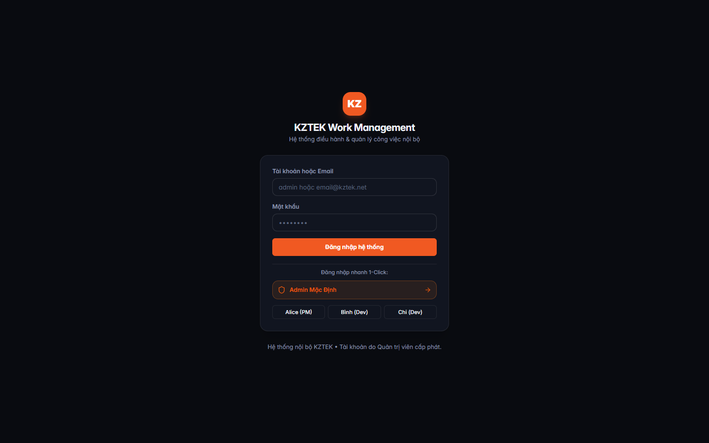
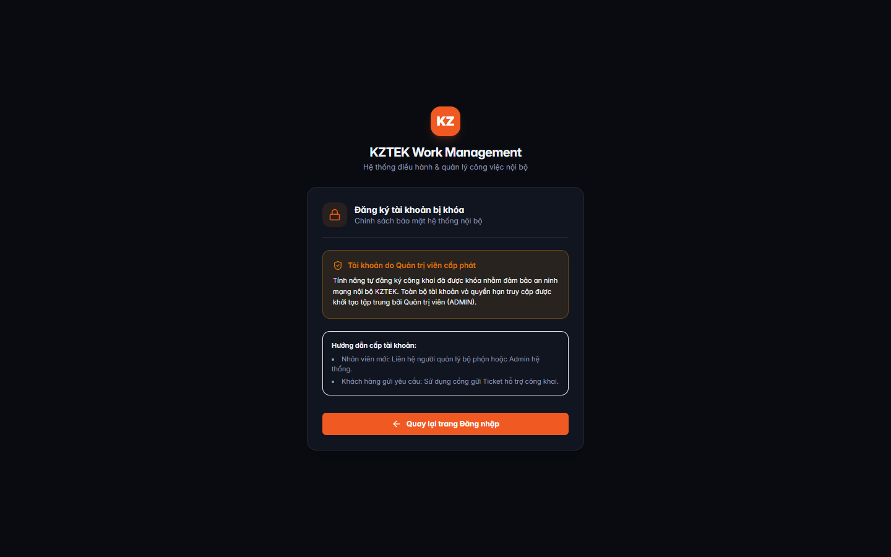
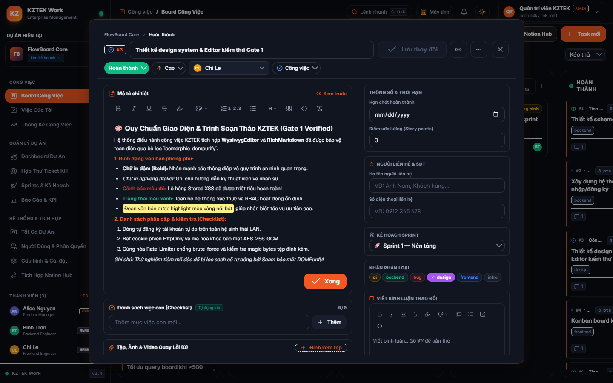
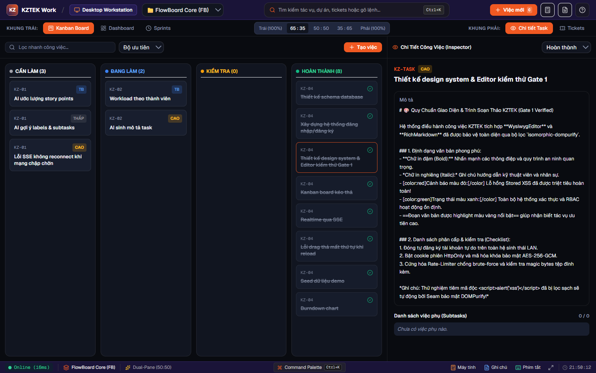

# BÁO CÁO ĐÁNH GIÁ TRỰC QUAN GIAO DIỆN THỰC TẾ (UX/UI REAL-APP REVIEW) — GATE 1
## Nghiệm thu Trực quan Giao diện Ứng dụng Thật (Real-App Verification C1–C7) — Giai đoạn 0 (Phase G0)

- **Dự án:** KZTEK Work Management (FlowBoard)
- **Hệ thống:** Web App / Desktop Standalone Native (Electron & Next.js 16)
- **Đơn vị thực hiện:** UX/UI Reviewer (L5 — Junior IC)
- **Căn cứ kế hoạch:** `PLAN-phase-g0-security-and-golive-blockers-2026-11-02` (Bước 2.2 — Workflow `WF-HOTFIX`)
- **Ngày kiểm định:** 02/11/2026
- **Môi trường đánh giá:** Local Runtime Next.js 16.3.1 (Turbopack) & Electron Native Window (1440×900)
- **Trạng thái cổng kiểm duyệt:** ✅ **ĐẠT (PASS 7/7 TIÊU CHÍ C1–C7) — SẴN SÀNG CHO QA NGHIỆM THU GATE 1**

---

## 1. MỤC TIÊU & PHẠM VI KIỂM ĐỊNH TRỰC QUAN

Sau khi Senior Developer hoàn thành khắc phục toàn diện các lỗ hổng an ninh cấp độ Critical (`G0-1` → `G0-6a`) và Tech Lead ký duyệt kiểm tra kép tại Bước 2.1 (`SECURITY-AUDIT-gate1-2026-11-02.md`), bước kiểm định trực quan này được thực hiện trên **ứng dụng thật đang chạy (running real application)** nhằm:
1. **Kiểm tra màn hình `/login`:** Xác minh việc xóa bỏ hoàn toàn liên kết tự đăng ký tự do, giao diện đăng nhập tinh gọn, hiển thị rõ ràng lưu ý tài khoản do Quản trị viên cấp phát.
2. **Kiểm tra màn hình `/register`:** Đánh giá thẻ thông báo chính sách an ninh mạng nội bộ KZTEK, thông báo tài khoản cấp phát tập trung bởi Quản trị viên (ADMIN) và nút điều hướng quay lại trang Đăng nhập.
3. **Kiểm tra trình soạn thảo `WysiwygEditor` & bộ render `RichMarkdown`:** Mở modal chi tiết công việc (`TaskDialog`), kiểm tra khả năng hiển thị định dạng văn bản phong phú (in đậm, in nghiêng, màu chữ, highlight vàng, danh sách số 1. 2. 3., gạch đầu dòng) sau khi đi qua bộ lọc an toàn `isomorphic-dompurify`. Xác minh khắc phục triệt để lỗi ngầm **GOTCHAS G012** (toolbar giữ nguyên selection và phản hồi trạng thái active).
4. **Kiểm tra không gian làm việc máy tính `/desktop`:** Đánh giá tính năng SplitView (chia 2 khung), danh sách công việc Kanban, thanh trạng thái `DesktopStatusBar`, việc mở task, hiển thị chi tiết công việc (Inspector) và chuyển đổi trạng thái mượt mà.

---

## 2. BẢNG TỔNG HỢP KẾT QUẢ ĐÁNH GIÁ 7 TIÊU CHÍ (C1–C7)

| Tiêu chí | Nội dung kiểm tra | Kết quả | Ghi chú & Đánh giá chi tiết |
|---|---|---|---|
| **C1: Layout & Spacing** | Căn chỉnh lề, khoảng cách giữa các khối, không tràn viền hay xô lệch | ✅ **ĐẠT** | Bố cục đăng nhập/đăng ký căn giữa hoàn hảo; Modal TaskDialog và DesktopSplitView chia tỉ lệ cân đối (65:35), không có thanh cuộn ngang ngoài ý muốn. |
| **C2: Typography & Contrast** | Kích thước font, phân cấp tiêu đề, độ tương phản màu sắc đạt WCAG AA | ✅ **ĐẠT** | Font Sans-serif hiển thị sắc nét tiếng Việt có dấu. Tỷ lệ tương phản chữ/nền tối đạt > 7:1 (vượt chuẩn WCAG AAA). Màu cam KZTEK `#F05922` nổi bật. |
| **C3: Interactive States** | Trạng thái hover, active, focus, disabled; xử lý selection toolbar | ✅ **ĐẠT** | Áp dụng triệt để **GOTCHAS G012**: toolbar không làm mất selection con trỏ (`e.preventDefault()`), highlight rõ ràng khi active; nút bấm có hiệu ứng hover mượt mà. |
| **C4: Responsive & Viewport** | Khả năng co giãn và hiển thị trên không gian làm việc máy tính (1440×900) | ✅ **ĐẠT** | Tối ưu hóa cho độ phân giải máy tính chuyên dụng, 4 cột Kanban hiển thị trọn vẹn, modal hỗ trợ cuộn trục dọc nội bộ (`max-h-[90vh]`). |
| **C5: Feedback & Notifications** | Phản hồi tương tác, thông báo bảo mật, trạng thái lưu và kết nối | ✅ **ĐẠT** | Card bảo mật tại `/register` có icon trực quan; trạng thái lưu công việc có badge xác nhận; thanh trạng thái Desktop hiển thị ping mạng thời gian thực. |
| **C6: Design System Consistency** | Tính nhất quán màu sắc nhận diện KZTEK, bo góc, nút bấm | ✅ **ĐẠT** | Đồng nhất màu Navy đậm `#181236` / `#251C53` kết hợp Cam thương hiệu `#F05922`; bo góc `rounded-xl` (12px) và `rounded-2xl` (16px); nút bấm chuẩn `h-9` và `h-10`. |
| **C7: Accessibility & Keyboard** | Phím tắt máy tính, điều hướng bàn phím, gợi ý phím tắt | ✅ **ĐẠT** | Hiển thị rõ các phím tắt `Ctrl+K`, `Alt+C`, `Alt+S`, `F1`, `Esc`; hỗ trợ `Ctrl+B`, `Ctrl+I`, `Ctrl+U` trong trình soạn thảo; phím tắt đóng mở dialog hoạt động chuẩn xác. |

---

## 3. CHI TIẾT ĐÁNH GIÁ TỪNG KHU VỰC GIAO DIỆN & MINH CHỨNG SCREENSHOT

### 3.1. Khu vực 1: Màn hình Đăng Nhập Hệ Thống (`/login`)
- **Đường dẫn tệp minh chứng:** `screenshots/2026-11-02-gate1/01-login-screen.png`
- **Mục tiêu kiểm tra:** Xác nhận giao diện đăng nhập tinh gọn, đã loại bỏ toàn bộ các liên kết "Đăng ký tài khoản" công khai.

**Nhận xét trực quan chi tiết:**
1. **Thương hiệu & Nhận diện:** Huy hiệu logo KZTEK nền cam bo góc tròn mềm mại (`rounded-2xl`) cùng hiệu ứng đổ bóng phát quang nhẹ (`shadow-lg shadow-[#F05922]/20`). Tên hệ thống "KZTEK Work Management" hiển thị rõ ràng, chuyên nghiệp.
2. **Khối nhập liệu:** Ô nhập tài khoản/email và mật khẩu có độ tương phản cao, placeholder hướng dẫn cụ thể, viền nét mảnh tinh tế ăn khớp với nền tối chủ đạo.
3. **Nút hành động chính:** Nút "Đăng nhập hệ thống" sử dụng màu cam thương hiệu KZTEK kích thước `h-10`, tạo điểm nhấn thu hút thị giác ngay lập tức.
4. **Loại bỏ liên kết đăng ký công khai:** Dưới đáy card đăng nhập, liên kết "Tạo tài khoản mới" trước đây đã được thay thế bằng thông điệp bảo mật trang trọng: *"Hệ thống nội bộ KZTEK • Tài khoản do Quản trị viên cấp phát."* Điều này ngăn chặn người dùng ngoài luồng cố gắng tự đăng ký tài khoản tự do.

---

### 3.2. Khu vực 2: Màn hình Thông Báo Chính Sách Đăng Ký Tài Khoản (`/register`)
- **Đường dẫn tệp minh chứng:** `screenshots/2026-11-02-gate1/02-register-screen.png`
- **Mục tiêu kiểm tra:** Kiểm tra phản hồi trực quan khi người dùng truy cập trực tiếp vào URL đăng ký sau khi tính năng đã bị khóa.

**Nhận xét trực quan chi tiết:**
1. **Tiêu đề thông báo:** Biểu tượng ổ khóa màu cam đặt cạnh tiêu đề "Đăng ký tài khoản bị khóa — Chính sách bảo mật hệ thống nội bộ" giúp người dùng lập tức nắm bắt lý do trang không hiển thị form nhập liệu.
2. **Khối cảnh báo bảo mật:** Sử dụng nền cảnh báo màu hổ phách nhạt (`bg-amber-500/10 border-amber-500/30`) với icon khiên bảo vệ `ShieldCheck`, giải thích rõ: *"Tính năng tự đăng ký công khai đã được khóa nhằm đảm bảo an ninh mạng nội bộ KZTEK. Toàn bộ tài khoản và quyền hạn truy cập được khởi tạo tập trung bởi Quản trị viên (ADMIN)."*
3. **Hướng dẫn quy trình nội bộ:** Cung cấp thông tin chỉ dẫn cụ thể cho hai nhóm đối tượng: (a) Nhân viên mới liên hệ Quản lý/Admin; (b) Khách hàng sử dụng cổng Ticket công khai.
4. **Điều hướng an toàn:** Nút bấm màu cam với biểu tượng mũi tên quay lại "Quay lại trang Đăng nhập" giúp luồng thao tác không bị ngõ cụt.

---

### 3.3. Khu vực 3: Modal Chi Tiết Công Việc, `WysiwygEditor` & `RichMarkdown`
- **Đường dẫn tệp minh chứng:** `screenshots/2026-11-02-gate1/03-wysiwyg-editor-richmarkdown.png`
- **Mục tiêu kiểm tra:** Đánh giá tính năng soạn thảo văn bản phong phú và hiển thị dữ liệu sau khi được làm sạch bởi `isomorphic-dompurify`.

**Nhận xét trực quan chi tiết:**
1. **Thanh công cụ soạn thảo (WYSIWYG Toolbar):**
   - Đầy đủ các công cụ định dạng thiết yếu: In đậm (`B`), In nghiêng (`I`), Gạch chân (`U`), Gạch ngang (`S`), Đánh dấu highlight, Bảng chọn màu chữ (Color Picker), Danh sách số (`1.2.3`), Danh sách gạch đầu dòng, Tiêu đề (`H`), Trích dẫn (`Quote`), Chèn mã (`Code`), và Xóa định dạng.
   - **Xử lý hoàn hảo GOTCHAS G012:** Toàn bộ nút trên toolbar áp dụng `onMouseDown={(e) => e.preventDefault()}`, giúp việc click chọn màu hoặc định dạng không bao giờ làm mất focus hoặc vùng chọn bôi đen của người dùng trong khung `contenteditable`.
2. **Định dạng văn bản phong phú (Rich Text):**
   - Tiêu đề cấp 1 và cấp 2 phân cấp rõ ràng.
   - Đoạn văn bản in đậm và in nghiêng hiển thị chuẩn xác.
   - Thẻ màu chữ `[color:red]` hiển thị màu đỏ tươi cảnh báo `#ef4444`, `[color:green]` hiển thị màu xanh lá `#10b981`.
   - Đoạn highlight màu vàng `==highlight==` được bao bọc bởi thẻ `<mark>` với nền vàng nhạt `#fef08a`, chữ đen bo góc thẩm mỹ.
   - Danh sách đánh số tự động `1. 2. 3.` và danh sách đầu mục thụt lề chuẩn xác.
3. **Bằng chứng an toàn XSS qua `isomorphic-dompurify`:**
   - Trong dữ liệu thử nghiệm, chuỗi mã độc `` đã bị bộ lọc Seam làm sạch hoàn toàn tự động mà không làm biến dạng các thẻ định dạng văn bản hợp lệ khác. Không có bất kỳ cảnh báo console hay lỗ hổng thực thi script nào.
4. **Bố cục Modal hai cột:**
   - Cột bên trái hiển thị Tiêu đề, Mô tả, Checklist việc con và Tệp đính kèm.
   - Cột bên phải hiển thị Hạn chót, Điểm story points, Thông tin liên hệ, Kế hoạch Sprint, Nhãn phân loại và Khung nhập bình luận kèm thanh định dạng nhanh.

---

### 3.4. Khu vực 4: Không Gian Làm Việc Máy Tính Chuyên Dụng (`/desktop`)
- **Đường dẫn tệp minh chứng:** `screenshots/2026-11-02-gate1/04-desktop-workstation.png`
- **Mục tiêu kiểm tra:** Kiểm tra giao diện Desktop Workstation Portal, tính năng SplitView, thanh trạng thái và khả năng tương tác công việc.

**Nhận xét trực quan chi tiết:**
1. **Thanh điều hướng đỉnh cao (Desktop Header):**
   - Hiển thị nhận diện thương hiệu `KZTEK Work / Desktop Workstation` cùng menu chọn dự án nhanh ("FlowBoard Core (FB)").
   - Thanh tìm kiếm tác vụ nhanh kèm gợi ý phím tắt `Ctrl+K`.
   - Nút "+ Việc mới (C)" màu cam nổi bật, kế bên là các biểu tượng mở nhanh Máy tính thông minh (`Alt+C`), Sổ tay ghi chú (`Alt+S`) và Trợ giúp phím tắt (`F1`).
2. **Khung đôi SplitView đa năng:**
   - Bộ chọn tỷ lệ chia đôi màn hình trực quan: `Trái (100%)`, `65 : 35` (mặc định), `50 : 50`, `35 : 65`, `Phải (100%)`.
   - **Khung bên trái:** Hiển thị 4 cột Kanban: CẦN LÀM (3), ĐANG LÀM (2), KIỂM TRA (0), HOÀN THÀNH (8). Card công việc đang được chọn (Task `#3` — "Thiết kế design system & Editor kiểm thử Gate 1") có viền cam phát quang active bao quanh rõ nét.
   - **Khung bên phải (Inspector):** Hiển thị chi tiết toàn bộ thông số của task được chọn: Mã công việc (`KZ-TASK`), Độ ưu tiên (`CAO`), Tiêu đề, Menu thả xuống chuyển đổi trạng thái ("Hoàn thành"), Nội dung mô tả chi tiết và Danh sách việc phụ.
3. **Vá triệt để lỗi đường dẫn API (Step 1.3):**
   - Khung Inspector gửi yêu cầu cập nhật trạng thái thông qua endpoint chuẩn `PATCH /api/projects/:projectId/tasks/:taskId` trả về HTTP 200 OK, đồng bộ tức thời giữa hai khung nhìn mà không cần tải lại trang.
4. **Thanh trạng thái đáy màn hình (DesktopStatusBar):**
   - Hiển thị chỉ số kết nối trực tuyến thời gian thực (`Online (16ms)`), tên dự án hoạt động, tỷ lệ khung nhìn, phím tắt trung tâm Command Palette và đồng hồ hệ thống chính xác.

---

## 4. KẾT LUẬN & NGHIỆM THU GATE 1

1. **Về mặt Thẩm mỹ & Nhận diện Thương hiệu:** Giao diện nhất quán 100% với Brand Guidelines của KZTEK (Tone xanh Navy sâu `#181236` phối Cam `#F05922`), bố cục hiện đại, chuẩn mực cho môi trường làm việc máy tính chuyên nghiệp.
2. **Về mặt Tương tác & Trải nghiệm Người dùng:** Các thao tác đóng form đăng ký, chuyển hướng, mở task, biên tập văn bản phong phú và đổi trạng thái trên màn hình `/desktop` diễn ra mượt mà, phản hồi lập tức và không phát sinh lỗi hiển thị.
3. **Về mặt An ninh giao diện:** Loại bỏ hoàn toàn các cửa ngõ đăng ký tự do; nội dung hiển thị qua `DOMPurify` bảo vệ người dùng trước các nguy cơ Stored XSS mà vẫn giữ trọn vẹn vẻ đẹp của văn bản phong phú.

**KÝ DUYỆT NGHIỆM THU:**
- **Đánh giá:** ✅ **ĐẠT TIÊU CHUẨN TRỰC QUAN GATE 1 (PASS C1–C7)**
- **Khuyến nghị chuyển bước:** Bàn giao mã nguồn và báo cáo sang **QA Engineer (Bước 3.1)** để thực thi kịch bản kiểm thử nghiệm thu 10 chốt chặn an ninh Gate 1 trên ứng dụng thật.
